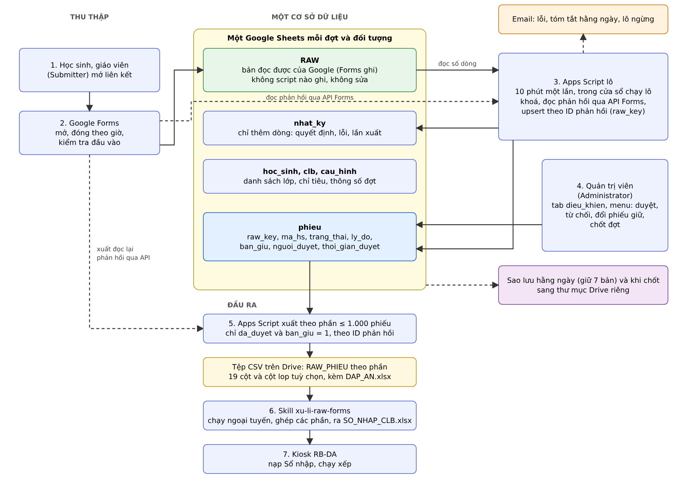
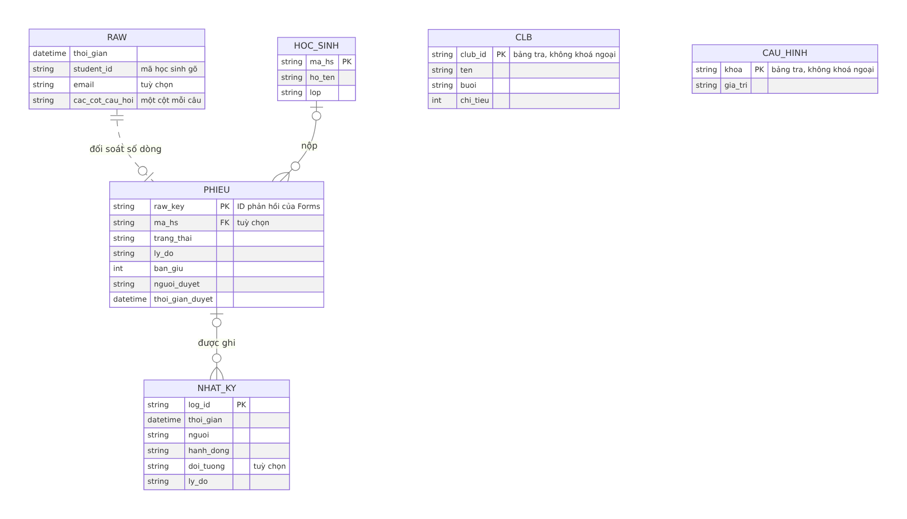
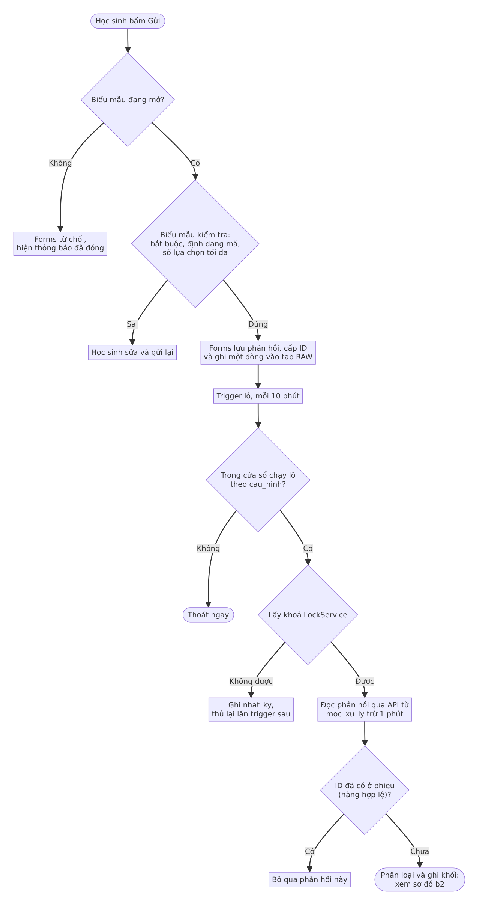
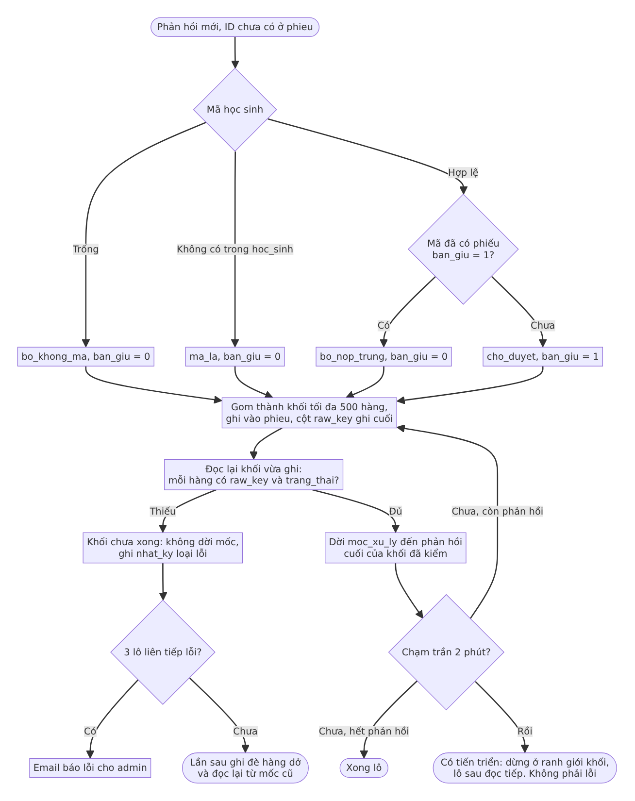
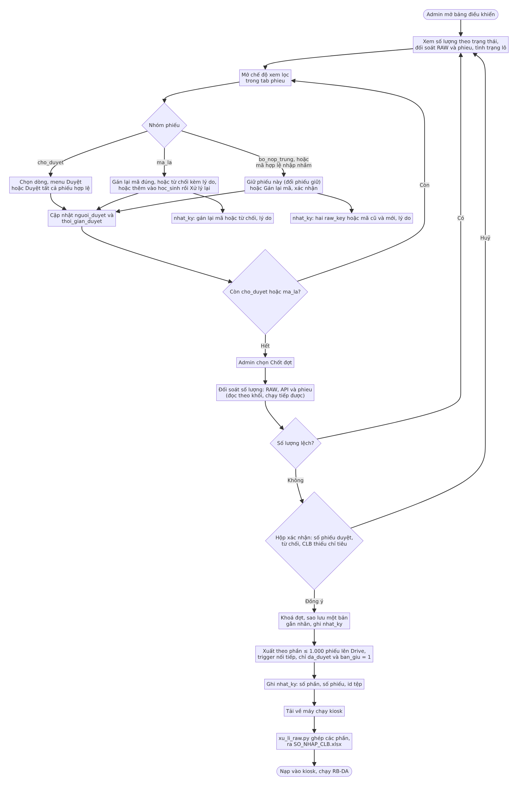
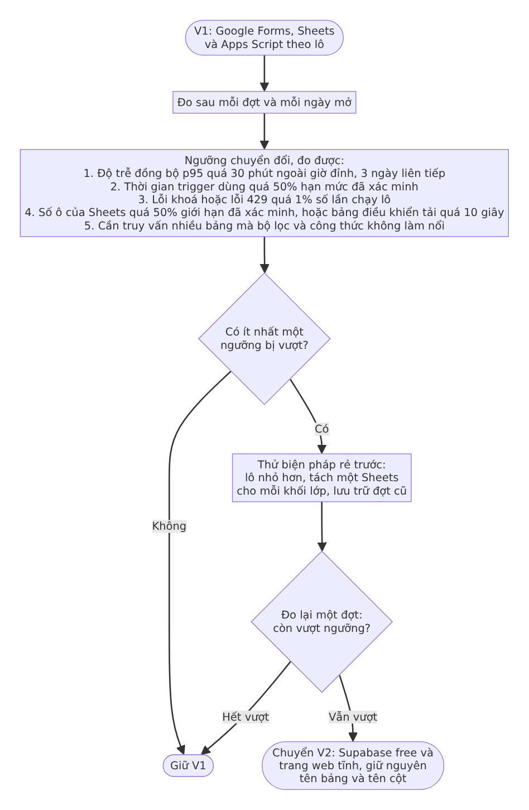

# T4. Mô hình hệ sinh thái thu thập và quản lý dữ liệu (bản đề xuất để duyệt, sửa vòng 2)

Trạng thái: ĐỀ XUẤT, chưa triển khai, chờ Truong duyệt. Soạn 03/11/2026, sửa vòng 1 và vòng 2 cùng ngày.
Phạm vi: thu thập đăng ký và thi tuyển CLB, quản lý, duyệt, xuất sang kiosk RB-DA.

> **Hai hạn chế (đọc trước).**
> 1. Phiên soạn bị chính sách mạng chặn nên **không mở được trang tham khảo của giáo viên** (`magenta-crepe-416060.netlify.app/dang-ky-clb`). Phần hiện trạng dựa trên mã và skill trong kho. Xem mục 2.2 và 16.
> 2. Không mở được trang hạn mức chính thức của Google, Microsoft, Supabase. Mọi số hạn mức và giá lấy từ **tóm tắt kết quả tìm kiếm**, mang nhãn **TT-CXM** = "CHƯA XÁC MINH (tóm tắt tìm kiếm, 03/11/2026)" kèm địa chỉ cần kiểm. Mọi nhận định về **hành vi** của Google Forms và Sheets mang nhãn **GĐ-n** (giả định chưa kiểm, bảng ở mục 3.2). Không con số hay hành vi nào trong tài liệu được khẳng định là đã đo.
>
> Thiết kế được chọn để vẫn đứng vững nếu các hạn mức sai lệch 2 lần (mục 9.3).

---

## 1. Tóm tắt điều hành (khuyến nghị trong 10 dòng)

1. Chọn **Phương án 1: Google** (Forms, Sheets, Apps Script, Drive). Chi phí 0 đồng, không máy chủ, quản trị viên không cần kỹ thuật.
2. **V1 gọn**: một Google Sheets mỗi đợt (và đối tượng) với sáu tab: `RAW` (tab của Forms, không script nào ghi vào), `hoc_sinh`, `clb`, `phieu` (một tab duyệt duy nhất), `nhat_ky`, `cau_hinh`, cộng một tab công thức `dieu_khien`.
3. **Không nhân đôi logic chấm.** Việc chấm và soát chỉ nằm ở `xu-li-raw-forms`. Admin không sửa câu trả lời: chỉ duyệt, từ chối, hoặc đổi phiếu nào được giữ (`ban_giu`). Câu trả lời sai thì học sinh nộp lại.
4. Apps Script **xử lý theo lô** và đọc phản hồi mới **qua API của Forms**; khoá của mỗi phiếu là **ID phản hồi** của Forms (GĐ-13). Ghi `phieu` bằng upsert theo ID, dời con trỏ sau cùng: chạy lại hay bị ngắt ở phút thứ 6 không tạo bản trùng.
5. **Xuất = lọc theo danh sách đã duyệt**, đọc lại phản hồi qua API, ghi thành **các tệp CSV riêng trên Drive** (mỗi phần tối đa 1.000 phiếu, chạy tiếp được bằng trigger nối tiếp), không bao giờ là một tab, để ngân sách ô của Sheets chỉ chứa RAW dạng rộng và các tab nhỏ.
6. Lớp đến kiosk bằng thay đổi nhỏ trong kho (mục 11.2): cột thứ 20 `lop` lấy từ `hoc_sinh`, skill `xu-li-raw-forms` ghi vào cột Lớp của Sổ. Hợp đồng CSV của kiosk không đổi.
7. Việc quan trọng (chốt đợt, đổi phiếu giữ, từ chối) cần admin xác nhận trong hộp thoại và có dòng `nhat_ky`.
8. Ngưỡng chuyển sang Supabase đo được (mục 10). Microsoft bị loại vì Power Apps và Dataverse cần gói trả tiền.
9. Việc đầu tiên khi mở mạng: kiểm các trang ở mục 16.
10. Truong cần quyết các câu hỏi ở mục 14.2, trước hết là loại tài khoản Google của trường, và hai quyết định thiết kế DEC-1, DEC-2 ở mục 11.

---

## 2. Hiện trạng và trang tham khảo

### 2.1 Hiện trạng trong kho (đã đọc)

| Bước | Công cụ | Ghi chú |
|---|---|---|
| Dựng biểu mẫu | `TAO_GOOGLE_FORM.gs` | Top 1 đến Top 10 dạng thả xuống, tick tối đa 5 CLB thi, chỉ hiện đề CLB đã chọn, tự chấm |
| Thu thập | Google Forms | Học sinh nộp |
| Xuất raw | Hàm `chamTheoCLB` | Đọc `form.getResponses()`, tự bỏ phiếu trùng (giữ phiếu đầu), ra `RAW_PHIEU.xlsx` (dạng dài, 19 cột) và `DAP_AN.xlsx` trong thư mục Drive "Kết quả CLB ..." |
| Xử lý | `xu_li_raw.py` chạy trên máy | Chấm lại theo đáp án gốc, soát bất thường, ra `SO_NHAP_CLB.xlsx` |
| Nạp | Kiosk RB-DA | Nạp Sổ nhập, chạy xếp |

Khoảng trống: phải chép tay thư mục Drive về máy; không có nơi duyệt, từ chối từng phiếu; không có nhật ký; không có thông báo khi lỗi; chưa có khung nhiều đối tượng và nhiều đợt; không kiểm mã theo danh sách lớp trước khi nhận; Lớp chưa đi theo `RAW_PHIEU` nên Sổ nhập chưa có Lớp từ biểu mẫu.

### 2.2 Trang tham khảo của giáo viên: KHÔNG MỞ ĐƯỢC

Địa chỉ bị chặn (HTTP 403 ở bước CONNECT). Không có nội dung nào của trang được đọc, và tài liệu này **không suy đoán** trường, luồng hay giao diện của trang đó.

Đối chiếu trang tham khảo (làm khi mở được mạng):

| # | Việc cần kiểm | Dùng để quyết |
|---|---|---|
| 1 | Liệt kê trang con, nút, menu | Có phần quản trị hay chỉ có biểu mẫu |
| 2 | Từng trường: nhãn, kiểu (chữ, số, email, thả xuống, nhiều lựa chọn, tải tệp), bắt buộc hay không | So với yêu cầu loại trường |
| 3 | Kiểm tra đầu vào: định dạng mã, trùng mã, giới hạn số lựa chọn | So với mục 8 |
| 4 | Dữ liệu gửi đi đâu (Google Forms nhúng, Netlify Forms, API riêng, Sheets) | Tận dụng hay thay |
| 5 | Có giờ mở đóng, có chặn nộp khi đóng không | So với mở đóng theo giờ |
| 6 | Xác nhận sau khi nộp, có cho sửa phiếu không | Luồng người nộp, quy tắc "không sửa" |
| 7 | Tài khoản, đăng nhập hay ẩn danh | Vai trò, chống trùng |
| 8 | Chạy trên điện thoại, tốc độ tải | Đỉnh tải |
| 9 | Chỗ lưu và quota (Netlify: băng thông, số lần gửi biểu mẫu) | Chi phí ở 10.000 người nộp |
| 10 | Điểm đáng giữ lại (giao diện, chữ, bố cục) | "Nâng cấp trên nền cái cũ" |

---

## 3. Giả định

### 3.1 Quy mô (giả định thiết kế, không phải số đo)

Bốn đại lượng tách biệt:

| Đại lượng | Giả định | Cách dùng |
|---|---|---|
| Tổng người dùng đăng ký (có thể nộp) | 2.000 đến 10.000 mỗi chu kỳ | Cỡ `hoc_sinh` |
| Tổng phiếu nộp | Tối đa 1,3 phiếu mỗi người, tức **tối đa 13.000** | Cỡ `RAW` và `phieu` |
| Phiếu nộp đồng thời lúc đỉnh | 100 đến 300 phiếu trong phút đỉnh (1 đến 3% số người). **Không** giả định 10.000 cùng lúc | Đường nộp chỉ gồm Forms (GĐ-1, GĐ-2) |
| Khối lượng xử lý hằng ngày | Theo lô, mỗi lô trần 2 phút (mục 9.3) | Ngân sách trigger |

Vai trò: Submitter (học sinh, giáo viên) và Administrator (1 đến 2 người).

### 3.2 Giả định về hành vi Google (chưa kiểm, cần xác minh khi mạng mở)

| Mã | Giả định | Nếu sai thì |
|---|---|---|
| GĐ-1 | Google Forms hấp thụ được đỉnh nộp 100 đến 300 phiếu mỗi phút | Đợt thử đỉnh (mục 12); cân nhắc chia nhóm nộp theo lớp |
| GĐ-2 | Google tuần tự hoá việc ghi dòng vào tab phản hồi, không mất dòng | Đối soát số bấm Gửi với số dòng |
| GĐ-3 | Tab phản hồi chỉ được Google thêm dòng; script V1 không ghi vào. Sửa câu hỏi sau khi mở làm đổi cột | Quy tắc V1: không sửa biểu mẫu sau khi mở |
| GĐ-4 | Có đủ các loại trường: chữ, số, email, thả xuống, nhiều lựa chọn, tải tệp (số và email thực ra là chữ có kiểm tra định dạng) | Thu hẹp danh sách loại trường |
| GĐ-5 | Tuỳ chọn "cho phép sửa phản hồi" tắt được; tên đúng của tuỳ chọn cần kiểm | Vẫn an toàn: khoá là ID phản hồi, lô đọc qua API; sửa phản hồi chỉ làm nội dung đọc lần sau khác lần trước, đã tính ở mục 7.3 |
| GĐ-6 | Có hàm đóng nhận phản hồi (`setAcceptingResponses`) và đặt thông báo khi đóng | Đóng bằng tay |
| GĐ-7 | Dấu thời gian phản hồi có độ phân giải giây, nên hai phản hồi có thể trùng giây (nộp đồng thời lúc đỉnh) | Thiết kế đã xử lý: khoá là ID phản hồi, không phải dấu thời gian |
| GĐ-8 | Biểu mẫu kiểm tra được mã học sinh bằng biểu thức chính quy | Chỉ kiểm ở lô |
| GĐ-9 | "Giới hạn một phản hồi mỗi người" và tải tệp bắt buộc đăng nhập Google | Chống trùng chỉ theo mã học sinh (đã có) |
| GĐ-10 | Một lệnh `setValues` nhiều dòng có thể bị ngắt giữa chừng và để lại dòng ghi dở (một số ô đã ghi, một số còn trống) | Đã tính: cột khoá ghi cuối, ghi xong đọc lại kiểm (mục 7.2) |
| GĐ-11 | Sheets có lịch sử phiên bản dùng được làm lớp phụ cho nhật ký | Chỉ dựa vào `nhat_ky` |
| GĐ-12 | Ô trống trong lưới có thể vẫn tính vào trần ô | Quy tắc V1: xoá hàng và cột thừa |
| GĐ-13 | ID phản hồi (`FormResponse.getId()`) ổn định và duy nhất cho mỗi phản hồi, không đổi khi sắp xếp hay sửa tab RAW | Quay lại phương án dùng băm nội dung làm khoá (mục 11.1) |
| GĐ-14 | `form.getResponses(mốc thời gian)` trả các phản hồi sau mốc, đủ để đọc từng phần | Đọc toàn bộ rồi lọc (chậm hơn, xem mục 9.4) |
| GĐ-15 | Tốc độ đọc phản hồi qua API: khoảng 20 đến 100 mili giây mỗi phản hồi (giả định để tính thông lượng) | Mục 9.4 tính lại; quá 200 mili giây thì dùng phương án B ở mục 11.1 |
| GĐ-16 | `ScriptApp` tạo và xoá được trigger theo chu kỳ 10 phút và trigger một lần đặt giờ | Admin đặt trigger bằng tay theo hướng dẫn |

---

## 4. Năm ưu tiên ràng buộc và cách thiết kế đáp ứng

| Ưu tiên | Cách đáp ứng |
|---|---|
| 1. Chi phí thấp | Chỉ dùng Forms, Sheets, Apps Script, Drive: 0 đồng với tài khoản Google sẵn có. Không dùng gói trả tiền |
| 2. Quản trị tối thiểu, không kỹ thuật | Bảng điều khiển là chính Sheets, menu có sẵn nút; mọi việc thường gặp tối đa 3 bước (mục 6.3); không cài đặt gì ngoài việc dán mã một lần |
| 3. Bảo trì thấp, không máy chủ | Không máy chủ, không cơ sở dữ liệu thứ hai; 4 trigger cố định; Google lo hạ tầng |
| 4. Tin cậy: không mất, không nhân đôi, không hỏng thầm lặng | Lô đọc qua API, khoá bằng ID phản hồi; `phieu` là upsert theo ID, con trỏ dời sau cùng, cột khoá ghi cuối rồi đọc lại kiểm; đối soát số lượng RAW, API, `phieu`; sao lưu hằng ngày (mục 8) |
| 5. Mở rộng đơn giản | Mỗi đợt một Sheets, lưu trữ sau chốt; ngưỡng chuyển sang Supabase đo được (mục 10), tên bảng và cột giữ nguyên |

---

## 5. Ánh xạ yêu cầu sang thành phần

| Yêu cầu | Thành phần V1 | Ghi chú |
|---|---|---|
| 1. Tạo và quản lý biểu mẫu | Google Forms sinh bằng `TAO_GOOGLE_FORM.gs` (đã có) | |
| 1. Nhiều đối tượng, nhiều đợt | Mỗi (đợt, đối tượng) một Sheets, đặt tên `<năm>_<đợt>_<đối tượng>` trong một thư mục Drive; thông số đợt nằm ở `cau_hinh`. Không có sổ đăng ký đợt riêng | Tránh kho thứ hai |
| 1. Loại trường | Chữ, số, email, thả xuống, nhiều lựa chọn (GĐ-4); tải tệp hoãn sang sau V1 (GĐ-9) | |
| 1. Mở, đóng biểu mẫu | Hai trigger theo giờ đã đặt trong `cau_hinh` gọi hàm đóng nhận phản hồi (GĐ-6) | |
| 1. Kiểm tra đầu vào | Kiểm tra ở biểu mẫu (GĐ-8) và ở lô (mục 8) | |
| 1. Hạn chế trùng | Giữ phiếu có dấu thời gian sớm nhất của mỗi mã (`ban_giu`), phiếu sau là `bo_nop_trung` | Khớp luật skill |
| 2. Kho trung tâm, tìm, lọc, sửa | Một Sheets mỗi đợt; lọc bằng chế độ xem lọc; sửa chỉ ở `phieu` (trạng thái, lý do, `ban_giu`) | Không sửa câu trả lời |
| 2. Xuất Excel và CSV | Menu "Xuất": tệp RAW_PHIEU trên Drive (xlsx hoặc CSV); tải `phieu` bằng chức năng tải của Sheets | |
| 3. Bảng điều khiển, trạng thái | Tab `dieu_khien` (công thức) và menu tuỳ biến, mục 6.3 | |
| 3. Duyệt, từ chối, sửa | Menu duyệt hàng loạt, từ chối kèm lý do, đổi phiếu giữ | Mục 7.4 |
| 3. Phân quyền | Hai vai trò: Submitter, Administrator | Mục 6.2 |
| 3. Lịch sử và quyết định quan trọng | `nhat_ky` | Mục 6.1 |
| 4. Tự đồng bộ, tự động hoá | Trigger lô, xuất, sao lưu | Mục 7 |
| 4. Thông báo | Email lỗi, bản tóm tắt hằng ngày, báo khi lô ngừng chạy | Hạn mức email: TT-CXM |
| 4. Người duyệt cho quyết định quan trọng | Chốt đợt qua hộp thoại xác nhận | |
| 5. Xuất cho phần mềm khác | Tệp RAW_PHIEU 19 cột cộng `lop` (V1), `DAP_AN.xlsx` có sẵn; skill ra Sổ nhập | Mục 11 |
| 5. API, tích hợp | V1 dùng tệp (kiosk ngoại tuyến); API `doGet` thuộc mục hoãn | |
| 5. Cấu trúc nhất quán | Tên tab, cột cố định (mục 6.1); chuyển Supabase giữ nguyên | |

---

## 6. Kiến trúc và mô hình dữ liệu

### 6.0 Kiến trúc

Đầu ra V1 (thống nhất ở mục 5, 11, 13 và sơ đồ này): **một tệp RAW_PHIEU trên Drive** (cột `lop` thêm vào), `DAP_AN.xlsx` có sẵn; Sổ nhập do skill ra ngoại tuyến. Không có tab xuất.

### 6.1 Mô hình dữ liệu

Một Google Sheets mỗi (đợt, đối tượng). Một cơ sở dữ liệu duy nhất.

| Tab | Cột | Khoá | Ghi chú |
|---|---|---|---|
| `RAW` (tab phản hồi do Forms nối vào) | `thoi_gian`, `email` (tuỳ chọn, chỉ khi biểu mẫu thu email, GĐ-9), các cột câu hỏi (cột `student_id` là mã học sinh học sinh tự gõ) | Không có cột khoá | Bản **đọc được của Google**, dạng rộng, một dòng mỗi phiếu. **Lô không đọc nội dung từ đây**; chỉ dùng số dòng để đối soát (mục 7.3). Không script nào ghi vào (GĐ-3). Quy tắc: không sắp xếp hay lọc tại chỗ, dùng chế độ xem lọc |
| `hoc_sinh` | `ma_hs`, `ho_ten`, `lop` | PK `ma_hs` | Admin nhập danh sách lớp. Dữ liệu thật của học sinh, không đưa vào kho mã. Ánh xạ `ma_hs` sang `student_id` khi xuất |
| `clb` | `club_id`, `ten`, `buoi`, `chi_tieu` | PK `club_id` | Bảng tra riêng, không khoá ngoại tới `phieu`. Chỉ tiêu do nhà trường lập, dùng khi nạp Sổ nhập |
| `phieu` (tab duy nhất đã xử lý) | `raw_key`, `ma_hs`, `trang_thai`, `ly_do`, `ban_giu`, `nguoi_duyet`, `thoi_gian_duyet` | PK `raw_key` | Một dòng mỗi phản hồi. `raw_key` là **ID phản hồi của Forms** (GĐ-13). `ma_hs` là mã hiện hành (có thể do admin gán lại, mục 7.4), tuỳ chọn trỏ tới `hoc_sinh` (`ma_la` thì không khớp). Không sắp xếp tại chỗ, dùng chế độ xem lọc |
| `nhat_ky` | `log_id`, `thoi_gian`, `nguoi`, `hanh_dong`, `doi_tuong`, `ly_do` | PK `log_id` | Chỉ thêm dòng. `doi_tuong` tuỳ chọn: `raw_key`, `ma_hs` hoặc `ky`. Ghi lỗi lô, quyết định quan trọng (từ chối, đổi phiếu giữ, gán lại mã, chốt đợt), lần xuất |
| `cau_hinh` | `khoa`, `gia_tri` | PK `khoa` | Thông số đợt (`ky_id`, `ten`, `doi_tuong`, `mo`, `dong`, `form_id`, `trang_thai_ky`), con trỏ `moc_xu_ly` (dấu thời gian cuối đã xử lý), cờ `ghi_do`, địa chỉ email, giờ cài trigger gần nhất. Là bảng tra riêng, không khoá ngoại |
| `dieu_khien` | Công thức | không | Chỉ là hiển thị, không lưu dữ liệu |

`raw_key` = **ID phản hồi của Forms** (GĐ-13), một chuỗi duy nhất cho mỗi phản hồi, do Google cấp, đọc qua API. Không dùng số dòng, dấu thời gian hay băm nội dung. Hai phản hồi nộp cùng một giây vẫn có hai ID khác nhau nên không đè nhau (GĐ-7). Nếu GĐ-13 sai thì quay lại phương án dùng băm nội dung (mục 11.1).

Trạng thái `phieu.trang_thai`:

| Giá trị | Ý nghĩa | Vào xuất? |
|---|---|---|
| `cho_duyet` | Hợp lệ, chờ admin | Không |
| `da_duyet` | Admin đã duyệt | Có, nếu `ban_giu = 1` |
| `tu_choi` | Admin từ chối, có lý do | Không |
| `bo_nop_trung` | Mã đã có phiếu giữ, đây là phiếu sau (`ban_giu = 0`) | Không |
| `ma_la` | Mã không có trong `hoc_sinh` (khác `bo_khong_ma`) | Không, đến khi admin xử lý |
| `bo_khong_ma` | Không có mã học sinh | Không |

`ban_giu` = 1 cho phiếu được giữ của mỗi `ma_hs`, 0 cho phiếu còn lại.

### 6.2 Vai trò và bảo mật

- **Submitter**: chỉ có đường dẫn biểu mẫu, không có quyền vào Sheets.
- **Administrator**: 1 đến 2 người được chia sẻ quyền sửa. Không có vai trò thứ ba.
- Tab RAW và `nhat_ky` được bảo vệ ở mức cảnh báo; Apps Script chỉ thêm dòng vào `nhat_ky` và không ghi vào RAW.
- Giới hạn biểu mẫu theo tên miền và việc bắt đăng nhập: GĐ-9, câu hỏi mở 1 và 2.

### 6.3 Trải nghiệm quản trị

**Bảng điều khiển hợp nhất** (tab `dieu_khien`, toàn công thức đếm trên `phieu`, không lưu dữ liệu):
- Số lượng theo trạng thái: `cho_duyet`, `da_duyet`, `tu_choi`, `bo_nop_trung`, `ma_la`, `bo_khong_ma`, mỗi trạng thái một màu.
- Đối soát: số dòng RAW so với số dòng `phieu` hợp lệ; lệch thì ô chuyển đỏ (mục 7.3).
- Tình trạng lô: giờ chạy thành công gần nhất, số phút kể từ đó, lỗi gần nhất.
- Trạng thái đợt và thời gian còn lại đến giờ đóng.
- Số CLB còn thiếu chỉ tiêu trong `clb`.
- Lần xuất gần nhất: giờ, số phần, số phiếu, liên kết tệp.
- Tín hiệu mã sai nhưng hợp lệ: số email có nhiều hơn một mã học sinh (chỉ khi biểu mẫu thu email, GĐ-9).

Tối thiểu bắt buộc: số lượng theo trạng thái, đối soát, tình trạng lô và lỗi. Các khối còn lại (đếm CLB thiếu chỉ tiêu, lần xuất, tín hiệu email) là **TUỲ CHỌN**, bật khi admin yêu cầu.

**Số bước cho các việc chính** (đề xuất, cần thử với admin thật):

| Việc | Số bước |
|---|---|
| Duyệt hàng loạt các phiếu hợp lệ | 3: mở chế độ xem lọc `cho_duyet`, chọn các dòng, menu "Duyệt" (có thêm nút "Duyệt tất cả phiếu hợp lệ" kèm số lượng xác nhận) |
| Xử lý một phiếu lỗi (`ma_la`) | 3: chọn dòng, menu "Từ chối" (nhập lý do) hoặc menu "Gán lại mã" (nhập mã đúng). Cách khác cho `ma_la`: thêm học sinh vào `hoc_sinh` rồi bấm "Xử lý lại phiếu mã lạ" |
| Sửa một mã hợp lệ nhưng nhập nhầm (mã của người khác) | 3: chọn dòng, menu "Gán lại mã", nhập mã đúng và lý do |
| Đổi phiếu giữ cho một học sinh | 3: chọn phiếu muốn giữ, menu "Giữ phiếu này", xác nhận |
| Chốt đợt | 2: menu "Chốt đợt", xác nhận |
| Xuất | 1: menu "Xuất RAW_PHIEU" (tự chạy sau khi chốt) |
| Xem lỗi | 1: bấm liên kết trong email, mở `nhat_ky` |

**Thao tác hàng loạt**: duyệt, từ chối kèm một lý do chung cho nhiều dòng, tải danh sách.
**Thông báo lỗi**: email khi lô lỗi (tối đa một email mỗi giờ) và cảnh báo khi lô ngừng chạy hơn một giờ **trong cửa sổ chạy lô** (mục 7.6). Bản tóm tắt hằng ngày: **TUỲ CHỌN**.
**Dấu vết kiểm toán**: `nhat_ky` cho quyết định quan trọng; `phieu` giữ `nguoi_duyet` và `thoi_gian_duyet` của từng phiếu; lịch sử phiên bản của Sheets là lớp phụ (GĐ-11).

---

## 7. Luồng xử lý

### 7.1 Luồng nộp phiếu, đọc qua API, phân loại và ghi

Sơ đồ b1 (nộp phiếu và đọc):

Sơ đồ b2 (phân loại và ghi một khối):

### 7.2 Bảo đảm của lô: không trùng, an toàn khi ghi dở hoặc bị ngắt

- **Nguồn đọc là API của Forms, khoá là ID phản hồi.** Lô đọc `form.getResponses(mốc)` với mốc = `moc_xu_ly` trừ 1 phút (GĐ-14). Khoảng gối 1 phút bảo đảm không sót phản hồi nộp cùng giây hay sát mốc. Phản hồi có ID đã nằm ở `phieu` (hàng hợp lệ) thì bỏ qua. Nhờ đó hai phản hồi nộp **cùng một giây** đều được xử lý, vì ID khác nhau (GĐ-7).
- **Khoá**: `LockService` khoá script, một lô tại một thời điểm.
- **Mốc xử lý** `moc_xu_ly` = dấu thời gian lớn nhất trong các phản hồi đã ghi xong và kiểm xong. Mốc chỉ dời **sau cùng**.
- **Hàng hợp lệ** của `phieu` là hàng có cả `raw_key` và `trang_thai` khác trống. Lô ghi từng khối ≤ 500 dòng; **cột `raw_key` đặt cuối hàng và mỗi hàng ghi `raw_key` sau các cột khác**. Sau mỗi khối, lô **đọc lại** khối vừa ghi và kiểm từng hàng có đủ `raw_key` và `trang_thai`.
- **Ghi dở hoặc bị ngắt ở phút thứ 6** (GĐ-10): hàng thiếu `raw_key` hoặc `trang_thai` được coi là **chưa ghi**. Khối kế tiếp luôn bắt đầu ngay sau hàng hợp lệ cuối cùng liên tục, nên ghi đè lên các hàng dở. Phản hồi tương ứng sẽ được đọc lại vì mốc chưa dời qua nó, rồi ghi lại. Không có hàng trùng vì khoá là ID phản hồi.
- **Trần thời gian lô**: 2 phút. Chạm trần **không phải lỗi**: lô dừng ở ranh giới khối, dời mốc đến phản hồi cuối cùng đã ghi và kiểm xong, ghi một dòng "có tiến triển" và thoát; lô sau đọc tiếp. Chỉ ghi dở hoặc lỗi API mới là lỗi.
- Kết quả đọc lại không khớp (hàng thiếu khoá hoặc trạng thái) thì lô coi như khối đó chưa xong: không dời mốc, ghi `nhat_ky` loại lỗi.

### 7.3 Phát hiện lệch: một lớp duy nhất, đối soát số lượng

- V1 tắt "cho phép sửa phản hồi" (GĐ-5). Vì lô đọc qua API và khoá là ID, việc sắp xếp, chèn hay xoá dòng ở tab RAW **không ảnh hưởng** đến lô. Quy tắc vận hành vẫn là: không sắp xếp hay lọc tại chỗ ở RAW và `phieu`, dùng chế độ xem lọc.
- Lớp phát hiện duy nhất: **đối soát số lượng**. Mỗi lô so số dòng RAW (rẻ) với số hàng hợp lệ của `phieu`; lệch quá số phản hồi đang chờ (lô chưa kịp xử lý) thì ô đối soát chuyển đỏ và có email. Trước khi chốt đợt, đối soát đầy đủ ba nguồn: số dòng RAW, số phản hồi đếm qua API (đọc theo khối, chạy tiếp được) và số hàng hợp lệ của `phieu`.
- Nếu số RAW nhỏ hơn số `phieu`: có người xoá dòng ở RAW. Không mất phiếu vì dữ liệu gốc ở Forms; ghi `nhat_ky` và cảnh báo.
- Không còn trạng thái `raw_doi`, không còn băm nội dung và không còn kiểm băm toàn bộ trước chốt.

### 7.4 Bỏ trùng, đổi phiếu giữ, gán lại mã

- **Luật: "đầu" = sớm nhất theo dấu thời gian phản hồi**, khớp luật của skill (giữ phiếu đầu của mỗi mã). Hai phản hồi cùng giây: xếp theo ID phản hồi (cố định, có thể đổi bằng "Giữ phiếu này").
- Khi lô ghi một dòng **mới** có `ma_hs` hợp lệ: nếu mã đã có dòng `ban_giu = 1` thì dòng mới là `bo_nop_trung`, `ban_giu = 0`; chưa có thì `cho_duyet`, `ban_giu = 1`.
- **Đánh giá lại** (khi một dòng `ma_la` được xử lý lại thành mã hợp lệ, hoặc khi "Gán lại mã" cho ra mã hợp lệ): lô xếp hạng lại nhóm của `ma_hs` đó theo dấu thời gian, phản hồi sớm nhất thắng, **trừ** hai trường hợp admin quyết định thắng: (a) nhóm có ghi nhận đổi phiếu giữ trong `nhat_ky`; (b) phiếu đang giữ đã `da_duyet`. Trong hai trường hợp này dòng sớm hơn đến muộn được đặt `bo_nop_trung` kèm `ly_do` "có phiếu sớm hơn, admin xem lại", và admin có thể đổi bằng "Giữ phiếu này".
- **Học sinh nộp lại để sửa câu trả lời**: phiếu sau mặc định là `bo_nop_trung`. Admin dùng menu "Giữ phiếu này" (3 bước): phiếu chọn thành `ban_giu = 1`, `cho_duyet`; phiếu giữ trước thành `ban_giu = 0`, `bo_nop_trung`; ghi `nhat_ky` (ai, lúc nào, hai `raw_key`, lý do). Đã xuất rồi thì xuất lại: mỗi lần xuất là một bộ tệp mới có giờ trong tên, không ghi đè; kiosk dùng bộ mới nhất.
- **Mã nhập nhầm** (hai trường hợp: mã không có trong danh sách, hoặc mã hợp lệ nhưng là mã của người khác): admin dùng menu **"Gán lại mã"** (3 bước: chọn dòng, nhập mã đúng, nhập lý do). Hệ thống kiểm mã mới có trong `hoc_sinh`, cập nhật `phieu.ma_hs`, ghi `nhat_ky` (mã cũ, mã mới, lý do), rồi đánh giá lại nhóm như trên. **Câu trả lời không bị đụng.** Khi xuất, mã đã gán lại được ghi vào cột `student_id` và dòng `[student_id]` của `RAW_PHIEU`; mã học sinh tự gõ ban đầu vẫn còn ở RAW, API và `nhat_ky`.
- **Hậu quả của mã hợp lệ nhập nhầm** nếu không ai phát hiện: phiếu được tính cho học sinh khác; phiếu thật của người đó, nếu nộp sau, trở thành `bo_nop_trung`. **Tín hiệu phát hiện** (tuỳ chọn, khi biểu mẫu thu email, GĐ-9): số email có nhiều hơn một mã học sinh, hiện trên `dieu_khien`; báo cáo của skill cũng bắt "một email nhiều mã".
- Báo cáo của skill sẽ **ít phiếu trùng hơn trước**, vì xuất đã lọc sẵn. Nơi chứa các bất thường nay là tab `phieu`; báo cáo của skill vẫn bắt các lỗi khác (đáp án lệch, thiếu xếp hạng).
- Mã không có trong `hoc_sinh` là `ma_la`; không có mã là `bo_khong_ma`. Hai trạng thái này có `ban_giu = 0` cho đến khi xử lý.

### 7.5 Luồng duyệt và xuất sang kiosk

### 7.6 Vòng đời trigger

Một hàm thiết lập và một nút menu **"Cài lại trigger"** (`caiLaiTrigger`), chạy **idempotent** (xoá hết trigger của script rồi tạo lại theo `cau_hinh`):

| Thời điểm hiện tại so với đợt | Trigger được tạo |
|---|---|
| Trước giờ mở | trigger một lần "mở" (đặt giờ mở) và trigger một lần "đóng" (đặt giờ đóng cộng 2 giờ) |
| Trong cửa sổ (mở đến đóng cộng 2 giờ) | trigger lô mỗi 10 phút, trigger hằng ngày (sao lưu và cảnh báo lô ngừng), trigger "đóng" |
| Sau đóng, trước chốt | chỉ trigger hằng ngày (sao lưu) |
| Sau chốt | không có trigger nào |

- Trigger "mở" tạo trigger lô và trigger hằng ngày; trigger "đóng" xoá trigger lô và **chỉ** nó (trigger hằng ngày giữ đến khi chốt đợt, để sao lưu quyết định duyệt). Hành động **Chốt đợt** xoá trigger hằng ngày.
- `caiLaiTrigger` được gọi khi tạo đợt và **mỗi khi admin đổi cửa sổ mở, đóng trong `cau_hinh`** (admin bấm nút; `dieu_khien` hiện cảnh báo khi cửa sổ trong `cau_hinh` khác cửa sổ đã cài lần gần nhất).
- Cảnh báo "lô ngừng chạy hơn một giờ" **chỉ hiện trong cửa sổ chạy lô**; ngoài cửa sổ không có cảnh báo.
- Số trigger tối đa cùng lúc: lô, hằng ngày, mở, đóng và một trigger nối tiếp xuất (mục 11.3) là 5, thấp hơn trần 20 mỗi người mỗi script (TT-CXM).

---

## 8. Độ tin cậy

| Rủi ro | Biện pháp |
|---|---|
| Mất phiếu thầm lặng | Dữ liệu gốc do Forms giữ, không script nào ghi vào RAW; đối soát số dòng RAW, số phản hồi qua API và số hàng hợp lệ của `phieu` (mục 7.3); lệch thì ô điều khiển đỏ và có email |
| Nhân đôi phiếu | Khoá là ID phản hồi, upsert; mã học sinh trùng chỉ giữ phiếu đầu (mục 7.4) |
| **Xác thực đầu vào** | Ba lớp. (1) Biểu mẫu: bắt buộc, giới hạn số lựa chọn, kiểm mã bằng biểu thức chính quy (GĐ-8). (2) Lô: mã có trong `hoc_sinh`, trùng. (3) Xuất: skill soát bằng `soat()` (9 điều bắt buộc của phần mềm) và thử nạp Sổ bằng phần mềm thật |
| Hỏng dữ liệu | Nội dung gốc không bị sửa; chỉnh ở `phieu` có `nguoi_duyet`, `thoi_gian_duyet` và dòng `nhat_ky` cho quyết định quan trọng |
| Nộp đồng thời | Forms hấp thụ (GĐ-1, GĐ-2); hai phản hồi cùng giây vẫn có ID khác nhau; lô dùng khoá script, một lô tại một thời điểm |
| Hàng ghi dở khi lô bị ngắt (GĐ-10) | Cột khoá ghi cuối; hàng thiếu khoá hoặc trạng thái coi như chưa ghi và bị ghi đè; đọc lại kiểm sau mỗi khối (mục 7.2) |
| Vượt hạn mức tự động hoá | Ngân sách mục 9.3 và theo dõi trên trang Executions |
| Đồng bộ lỗi | Chạy lại an toàn (mục 7.2); email sau 3 lô liên tiếp lỗi |
| Nhất quán | Mỗi lô: ghi `phieu`, đọc lại kiểm, ghi `nhat_ky` nếu có lỗi, rồi dời mốc |
| Sao lưu và khôi phục | Mặc định: một trigger hằng ngày chép toàn bộ Sheets sang thư mục Drive riêng, **giữ 7 bản**; thêm một bản gắn nhãn khi **chốt đợt** và nút "Sao lưu ngay". Giữ 14 bản hay sao lưu mỗi giờ: tuỳ chọn, hoãn (mục 13.2) |
| Chỉnh nhầm tab RAW hoặc `phieu` | Hoàn nguyên từ lịch sử phiên bản (GĐ-11) hoặc bản sao lưu. Dựng lại `phieu` từ Forms: xoá `phieu`, đặt lại `moc_xu_ly`, chạy lô lại (mất quyết định duyệt đến lần sao lưu gần nhất) |

Xử lý nặng làm theo **lô**, không theo từng phiếu.

---

## 9. Hạn mức, kích cỡ và biên an toàn

### 9.1 Bảng hạn mức và nguồn

Tất cả: **Trạng thái nguồn = CHƯA XÁC MINH (tóm tắt tìm kiếm, 03/11/2026)**. Chưa đọc trang gốc nào.

| Hạn mức | Số liệu trong tóm tắt | Nguồn chính thức cần kiểm | Nguồn trong kết quả tìm kiếm |
|---|---|---|---|
| Apps Script: thời gian một lần chạy | 6 phút | `developers.google.com/apps-script/guides/services/quotas` | `developers.google.com/apps-script/quotas` |
| Apps Script: tổng thời gian trigger mỗi ngày | 90 phút (tài khoản thường), 6 giờ (Workspace) | như trên | như trên |
| Apps Script: trigger mỗi người mỗi script | 20 | như trên | như trên |
| Apps Script: thực thi đồng thời | 30 mỗi người, 1.000 mỗi script | như trên | như trên |
| Sheets API đọc và ghi mỗi phút | 300 và 300 mỗi dự án; 60 và 60 mỗi người mỗi dự án; quá thì lỗi 429; một nguồn nói tương lai có thể tính phí. V1 dùng `SpreadsheetApp`, chưa phụ thuộc | `developers.google.com/workspace/sheets/api/limits` | `developers.google.com/sheets/api/limits` |
| Trần ô Google Sheets | 10 triệu (thông báo 2022); một nguồn nói 20 triệu, chưa kiểm | trang giới hạn của Google Sheets trên `support.google.com` (địa chỉ chính xác chưa biết) | `workspaceupdates.googleblog.com/2022/03/ten-million-cells-google-sheets.html` |
| Google Forms nối Sheets | Báo cáo lẻ: Sheets nối ngừng nhận ở khoảng 100.000 phiếu | trang trợ giúp Google Forms | `blog.g-gen.co.jp/entry/limit-for-google-forms-spreadsheet-sync` (thứ ba) |
| LockService | `waitLock` báo lỗi khi hết giờ chờ; `tryLock` trả false; web app độc lập dùng khoá script. Chưa thấy trần thời gian khoá | `developers.google.com/apps-script/reference/lock/lock-service` | cùng trang |
| Email `MailApp` mỗi ngày | Chưa tìm được | trang quota Apps Script | không có |
| Microsoft Forms connector | 300 lệnh gọi mỗi kết nối trong 60 giây; một nguồn nói chu kỳ thăm 86.400 giây (nghi ngờ) | `learn.microsoft.com/en-us/connectors/microsoftforms/` | cùng trang |
| Power Automate miễn phí | Luồng tắt sau 90 ngày không kích hoạt (nguồn cộng đồng); hạn mức hành động mỗi ngày: chưa tìm được | `learn.microsoft.com/en-us/power-automate/limits-and-config` | `powerusers.microsoft.com` (không chính thức) |
| Microsoft Forms số phản hồi | 200 đến 5.000.000 tuỳ gói (thứ ba) | trang Forms của Microsoft | `gappsy.com/tools/microsoft-forms/` |
| Supabase miễn phí | 500 MB cơ sở dữ liệu, 5 GB egress, 1 GB tệp, 50.000 MAU, 2 dự án, tạm dừng sau 1 tuần không hoạt động, không sao lưu tự động | `supabase.com/pricing`; `supabase.com/docs/pricing` | cùng trang |
| Supabase Pro | 25 đô mỗi tháng; 8 GB đĩa; 250 GB băng thông (một nguồn thứ ba nói 50 GB, mâu thuẫn); sao lưu hằng ngày giữ 7 ngày | như trên | như trên |

Google nói hạn mức "có thể đổi hoặc bỏ bất cứ lúc nào, không báo trước" (theo tóm tắt, TT-CXM).

### 9.2 Ngân sách ô cho 13.000 phiếu (tối đa)

Bố cục: tab `RAW` dạng rộng, một dòng mỗi phiếu, mỗi câu hỏi một cột.

| Thành phần | Công thức | Điển hình (C = 220) | Xấu nhất (C = 400) |
|---|---|---|---|
| `RAW` | 13.000 phiếu nhân C cột | 2,86 triệu | 5,20 triệu |
| `phieu` | 13.000 nhân 7 cột | 0,09 triệu | 0,09 triệu |
| `hoc_sinh` | 10.000 nhân 3 cột | 0,03 triệu | 0,03 triệu |
| `nhat_ky` | giả định 5.000 dòng nhân 6 cột | 0,03 triệu | 0,03 triệu |
| `clb`, `cau_hinh`, `dieu_khien` | nhỏ | dưới 0,02 triệu | dưới 0,02 triệu |
| **Tổng** | | **khoảng 3,0 triệu** | **khoảng 5,4 triệu** |

Nguồn của C: **C = 220** là ước tính cho biểu mẫu mẫu 50 CLB (khoảng 100 câu đề thi, 65 câu đăng ký và xếp hạng của 5 buổi, tối đa 50 câu chọn thi tiếp), chưa đếm từ biểu mẫu thật. **C = 400** là ngưỡng mà skill `tao-google-form-clb` nói nên chia hai biểu mẫu (khoảng 400 câu hỏi). Số phiếu 13.000 là giả định ở mục 3.1.

So với trần 10 triệu (TT-CXM): điển hình dư 3,3 lần; xấu nhất dư 1,9 lần.
**Nếu trần thật chỉ bằng một nửa (5 triệu):** điển hình vẫn đủ (3,0 dưới 5), **xấu nhất không đủ** (5,4 trên 5). Vì vậy quy tắc V1: tích số phiếu tối đa nhân số cột RAW không vượt 4,5 triệu, tức với 13.000 phiếu thì **không quá khoảng 340 câu hỏi mỗi biểu mẫu**, vượt thì chia hai biểu mẫu theo nhóm buổi. Xoá hàng và cột thừa của lưới (GĐ-12).

Tệp xuất dạng dài là tệp **riêng**, không tính vào Sheets của đợt. Dạng dài có số ô lớn: giả định 40 dòng mỗi phiếu nhân 20 cột, 13.000 phiếu là khoảng 10 triệu ô. Vì vậy V1 xuất **CSV theo phần ≤ 1.000 phiếu** ghi thẳng vào Drive bằng `DriveApp`, không dựng bảng tạm (mục 11.3). Con số 40 dòng mỗi phiếu là giả định, cần đếm trên biểu mẫu mẫu.

### 9.3 Ngân sách trigger và biên 2 lần

Quy tắc: ngân sách thiết kế không quá **một phần ba** hạn mức thấp nhất nghe được (TT-CXM).

Trigger (mục 7.6): lô mỗi 10 phút, hằng ngày, mở, đóng, và một trigger nối tiếp xuất; tối đa 5 cùng lúc (so với trần 20, TT-CXM).

Ngày xấu nhất cho việc nhận phiếu: biểu mẫu mở cả 24 giờ, đỉnh nằm **trong** giờ mở (không cộng chồng):

| Hạng mục | Cách tính | Phút trigger mỗi ngày |
|---|---|---|
| Lô lúc bận | 8 lô bận mỗi ngày nhân trần 120 giây | 16,0 |
| Lô nhàn (đọc API không có phản hồi mới, thoát nhanh) | 144 lô tổng trừ 8 bận là 136 nhân khoảng 3 giây (giả định) | 6,8 |
| Sao lưu và cảnh báo hằng ngày | 1 lần nhân khoảng 90 giây (giả định) | 1,5 |
| Mở, đóng đợt | 2 lần nhân khoảng 10 giây (giả định) | 0,3 |
| **Tổng** | | **khoảng 24,6** |

Biến thể: **ngày đỉnh có 12 lô bận** (mục 9.4): 12 nhân 2 phút là 24,0 cộng 132 lô nhàn nhân 3 giây là 6,6 cộng 1,5 cộng 0,3 là **khoảng 32,4 phút**. Vượt mức 30 phút của quy tắc một phần ba nhưng dưới 45 phút (một nửa hạn mức 90 phút nếu số đó đúng, TT-CXM), nên vẫn có biên.

Ngày xuất (mục 11.3), lô đã ngừng: 10 phần xuất, mỗi phần giả định 200 giây là khoảng 33,3 phút, cộng sao lưu 1,5 là **khoảng 34,8 phút**, dưới 45 phút. Quy tắc: **tối đa một lần xuất đầy đủ mỗi ngày**; xuất lần hai trong cùng ngày có thể vượt hạn mức.

| Hạn mức (số trong tóm tắt, TT-CXM) | Mức dùng thiết kế | Nếu hạn mức thật bằng một nửa |
|---|---|---|
| Trigger 90 phút mỗi ngày | 24,6 phút (ngày thường), 32,4 (ngày đỉnh), 34,8 (ngày xuất) | Nửa là 45 phút: còn dư ở cả ba |
| 6 phút mỗi lần chạy | Trần lô 2 phút; phần xuất giả định 200 giây | Nửa là 3 phút: lô đủ, phần xuất **không đủ** nếu mỗi phần cần 200 giây; khi đó giảm cỡ phần xuống 500 phiếu |
| 20 trigger mỗi người mỗi script | Tối đa 5 | Nửa là 10: dư |
| Trần ô 10 triệu | 3,0 triệu điển hình, 5,4 triệu xấu nhất | Nửa là 5 triệu: điển hình dư, xấu nhất không đủ, nên có quy tắc 340 câu ở 9.2 |
| Thực thi đồng thời | Một lô, khoá script | Không phụ thuộc |

Các giả định 3 giây, 90 giây, 200 giây, 8 và 12 lô bận phải đo ở đợt thử (mục 12).

### 9.4 Thông lượng của lô và của xuất (ước tính, đo ở đợt thử)

Tất cả các con số trong mục này là **giả định cần đo** (GĐ-15), không phải kết quả.

**Nhận phiếu (đọc API).** Giả sử đọc và phân loại một phản hồi mất 20 đến 100 mili giây. Với trần lô 120 giây:

| Chi phí mỗi phản hồi | Sức chứa một lô |
|---|---|
| 20 mili giây | 6.000 phản hồi |
| 40 mili giây | 3.000 phản hồi |
| 100 mili giây | 1.200 phản hồi |

Dòng vào lúc đỉnh: 300 phản hồi mỗi phút nhân chu kỳ 10 phút là **3.000** phản hồi mỗi chu kỳ. Chi phí mỗi phản hồi từ 40 mili giây trở xuống thì sức chứa đủ dòng vào; **từ 100 mili giây thì không đủ**, và dồn ứ tăng 1.800 phản hồi mỗi chu kỳ trong lúc đỉnh. Ví dụ đỉnh kéo dài 30 phút (3 chu kỳ) tạo dồn ứ 5.400; sau đỉnh dòng vào giả định 20 phản hồi mỗi phút (200 mỗi chu kỳ), lô xả net 1.000 mỗi chu kỳ, nên dồn ứ hết sau khoảng 5,4 chu kỳ, tức khoảng **54 phút**. **Không mất phiếu**: phản hồi nằm ở Forms, lô chỉ chậm. Hệ quả: mục tiêu độ trễ 15 phút chỉ áp dụng ngoài giờ đỉnh; trong đỉnh và đến 2 giờ sau, mục tiêu là xả hết dồn ứ trong 2 giờ. Tổng 13.000 phản hồi ở 100 mili giây cần khoảng 11 lô bận, khớp biến thể 12 lô bận ở mục 9.3.

Biện pháp nếu đo ra chậm hơn: (1) nâng trần lô lên 4 phút (còn dưới 6 phút nhưng mất biên 2 lần, chỉ làm khi đã đo); (2) rút chu kỳ xuống 5 phút trong cửa sổ đỉnh; (3) nếu chi phí mỗi phản hồi vượt 200 mili giây (sức chứa dưới 600) thì dùng phương án B ở mục 11.1, đọc tab RAW dạng rộng bằng `getValues` theo khối, nhanh hơn nhiều nhưng cần băm nội dung làm khoá.

**Xuất.** Giả sử dựng, chấm và ghi một phiếu mất 100 đến 200 mili giây. Mỗi phần tối đa **1.000 phiếu** mất 100 đến 200 giây, dưới trần 6 phút (còn biên 1,8 lần ở mức xấu). 10.000 phiếu là 10 phần; mỗi phần xong thì tạo trigger nối tiếp chạy sau khoảng 1 phút. Tổng khoảng 10 nhân (100 đến 200 giây cộng 60 giây) là **27 đến 43 phút**; mục tiêu thiết kế **không quá 45 phút cho 10.000 phiếu, chạy tiếp được từng phần** nếu bị ngắt.

---

## 10. Ngưỡng chuyển đổi đo được (từ Sheets sang Supabase)

| # | Ngưỡng | Cách đo |
|---|---|---|
| 1 | Độ trễ đồng bộ p95 quá 30 phút ngoài giờ đỉnh, 3 ngày liên tiếp | Trong đợt thử bật cờ `ghi_do` (**TUỲ CHỌN**, chỉ ở đợt thử) ở `cau_hinh`: mỗi lô ghi một dòng `nhat_ky` loại "đo" (giờ nộp của phản hồi mới nhất, giờ xử lý xong) |
| 2 | Thời gian trigger dùng quá 50% hạn mức đã xác minh | Trang Executions của Apps Script, cộng thời gian mỗi ngày |
| 3 | Lỗi khoá hoặc lỗi 429 quá 1% số lần chạy lô | Đếm dòng lỗi trong `nhat_ky` so với tổng lần chạy |
| 4 | Số ô của Sheets quá 50% giới hạn đã xác minh, hoặc bảng điều khiển tải quá 10 giây | Đếm ô; đo bằng đồng hồ với 13.000 dòng |
| 5 | Cần truy vấn quan hệ nhiều bảng mà bộ lọc và công thức không làm nổi | Ghi yêu cầu thật của admin; hai lần liên tiếp thì tính |

Trước khi chuyển: thử biện pháp rẻ (lô nhỏ hơn, tách Sheets theo nhóm buổi, lưu trữ đợt cũ). Chuyển V2 chỉ khi vẫn vượt sau một đợt đo lại; V2 giữ nguyên tên bảng và cột. Các ngưỡng 30 phút, 50%, 1%, 10 giây là quyết định thiết kế cần Truong duyệt, chưa dựa trên số đo.

---

## 11. Đầu ra, tích hợp và thay đổi cần trong kho

Hợp đồng cột kiosk (CLAUDE.md, bất biến 7): `club_id, student_id, test_club_k, score_k, pref_k, <buoi>_pref_k`, cùng Lớp (cột Lớp đã có trong `so_nhap.py`, mục A14). V1 **không đổi hợp đồng này**.

Đầu ra V1: bộ tệp `RAW_PHIEU` (CSV theo phần) trên Drive, `DAP_AN.xlsx` sẵn có, rồi `xu_li_raw.py` ra `SO_NHAP_CLB.xlsx`. Phiếu `tu_choi`, `bo_nop_trung`, `ma_la`, `bo_khong_ma` không vào tệp xuất. Mỗi lần xuất là bộ tệp mới có giờ trong tên và ghi vào `nhat_ky` (số phần, số phiếu, id tệp).

Lọc: danh sách phiếu xuất là `trang_thai = da_duyet` và `ban_giu = 1`, khoá bằng ID phản hồi (`raw_key`). Việc dựng dòng, chấm và cột `diem_forms` dùng lại mã của `chamTheoCLB` (hiện đọc `form.getResponses()` và tự bỏ trùng giữ phiếu đầu); cần tham số "chỉ lấy các phản hồi có ID trong danh sách đã duyệt", áp dụng **trước** khi bỏ trùng, và tham số "ghi cột `lop`" mặc định tắt. Chưa đọc kỹ `chamTheoCLB` ở T4, cần xem trước khi triển khai có tái dùng được hay phải tách hàm.

### 11.1 DEC-1 (cho Truong chọn): nguồn đọc của lô và của xuất

| Lựa chọn | Ưu | Nhược |
|---|---|---|
| **A (khuyến nghị, nền của thiết kế này)** Lô và xuất đều đọc qua API của Forms, khoá là ID phản hồi (GĐ-13) | Một khoá, không băm, không `raw_doi`, sắp xếp RAW vô hại; xuất giữ đủ 19 cột kể cả `diem_forms`; dùng lại `chamTheoCLB` | Đọc API chậm hơn đọc ô (GĐ-15); phụ thuộc GĐ-13 và GĐ-14 |
| B (phương án lui) Lô đọc tab RAW dạng rộng bằng `getValues` theo khối; khoá là dấu thời gian, mã học sinh và băm 8 ký tự của nội dung dòng | Rất nhanh, nhiều nghìn dòng mỗi lần đọc | Phải thêm băm, điểm gác con trỏ, trạng thái dòng bị sửa, kiểm băm trước chốt; mất `diem_forms` nếu xuất cũng đọc từ tab |

**Ngưỡng chuyển từ A sang B** (đo ở đợt thử): chi phí đọc và phân loại **vượt 200 mili giây mỗi phản hồi** (sức chứa lô dưới 600), hoặc GĐ-13 sai (ID không ổn định). Chưa thể kết luận API đủ nhanh khi chưa đo; hiện giả định A đủ vì 13.000 phản hồi ở 100 mili giây xử lý hết trong khoảng 11 lô bận (mục 9.4) mà không mất phiếu.

### 11.2 Thay đổi cần trong kho (để Truong duyệt trước khi triển khai)

Cần đăng ký thành mục trong sổ (quy tắc làm việc 1 của CLAUDE.md), không làm trước khi được duyệt.

| # | Thay đổi | Tệp chạm | Ghi chú |
|---|---|---|---|
| 1 | **Lớp.** `lop` là cột tuỳ chọn **ngoài `COT_RAW`**: `COT_RAW` (`xu_li_raw.py` dòng 39, 19 cột) **không đổi**. Hàm `_can_cot` (định nghĩa dòng 80, gọi trong `chay` khoảng dòng 354) chỉ kiểm cột thiếu so với `COT_RAW` nên một cột thừa `lop` không làm lỗi. `xu_li_raw.py` đọc thêm cột `lop` nếu có trong tiêu đề và ghi vào cột Lớp của Sổ; thiếu cột thì hành vi **như cũ**. `chamTheoCLB` chỉ ghi cột `lop` khi được yêu cầu (tham số mặc định tắt), nên `COT_RAW` của `.gs` vẫn đúng bằng `COT_RAW` của skill | `mau_forms_thi_clb/DINH_DANG_RAW.md` (ghi cột tuỳ chọn thứ 20), `.claude/skills/xu-li-raw-forms/scripts/xu_li_raw.py` và `SKILL.md`, `tests/test_skill_xu_li_raw.py` (thêm test cho `lop`; đoạn dòng 256 đến 257 ghim `COT_RAW` của skill với `.gs` **phải giữ xanh**), `CHANGELOG.md` | Không đụng hợp đồng CSV của kiosk, vì Sổ đã có cột Lớp (A14). Cần đồng bộ tài liệu, skill và test cùng lúc |
| 2 | Hàm Apps Script mới: lô (`xuLyLo`), `caiLaiTrigger`, menu quản trị (duyệt, từ chối, giữ phiếu này, gán lại mã, chốt đợt, sao lưu ngay), xuất theo danh sách duyệt theo phần, ghi mã đã gán lại vào cột `student_id` và dòng `[student_id]`. Thêm vào khuôn `tao_google_forms.py` và `TAO_GOOGLE_FORM.gs` | `mau_forms_thi_clb/tao_google_forms.py`, `TAO_GOOGLE_FORM.gs`, `.claude/skills/tao-google-form-clb/`, `tests/test_skill_tao_google_form.py` | Skill nói `mau` rồi `tao` phải ra tệp giống hệt `TAO_GOOGLE_FORM.gs`: cập nhật cả hai cùng lúc |
| 3 | `xu_li_raw.py` nhận **một thư mục các phần CSV** cùng tiêu đề (hoặc nhiều `--raw`) và ghép lại | `xu_li_raw.py`, test | **Bắt buộc** khi một đợt có hơn 1.000 phiếu (xuất thành nhiều phần). Đợt tới 1.000 phiếu chỉ một phần, không cần |

**Khuyến nghị cho Lớp (DEC-2):** lấy `lop` từ `hoc_sinh` lúc xuất (thay đổi số 1), **không** thêm câu hỏi "Lớp" vào biểu mẫu. Lý do: không thêm trường cho học sinh gõ nên không lệch mã, một nguồn duy nhất, và `ma_la` đã chặn mã không có trong danh sách. Phương án còn lại (thêm câu hỏi "Lớp" bắt buộc) cần thêm một cột ở RAW, dễ gõ sai, và vẫn phải sửa `DINH_DANG_RAW.md` và skill như thay đổi số 1.

### 11.3 Xuất khối lượng lớn: theo phần, chạy tiếp được

Xuất chạy thành **các phần ≤ 1.000 phiếu**, mỗi phần là một tệp CSV (`RAW_PHIEU_<ky>_<giờ>_p01.csv`, `p02`, ...) ghi bằng `DriveApp`, không dựng bảng tạm. Khi admin bấm "Xuất", phần 1 chạy ngay; xong phần nào thì tạo **trigger nối tiếp** chạy phần kế sau khoảng 1 phút và tự xoá. Trạng thái xuất (phần đã xong) nằm ở `cau_hinh`, nên bị ngắt thì bấm "Xuất tiếp" hoặc để trigger chạy lại. Mục tiêu: không quá 45 phút cho 10.000 phiếu (mục 9.4). Đợt tới 1.000 phiếu chỉ một phần.

---

## 12. Mục tiêu hiệu năng và cách kiểm

Sáu chỉ số, bảy con số mục tiêu (chỉ số thứ sáu gồm RPO và RTO). Đây là **mục tiêu đề xuất**, không phải kết quả; chưa có số nào đạt hay đo được.

| # | Chỉ số | Mục tiêu đề xuất | Cách kiểm |
|---|---|---|---|
| 1 | Tỷ lệ nộp thành công | Từ 99,9% trở lên (bấm Gửi thành công và có dòng RAW) | Đợt thử với biểu mẫu thử, nhiều thiết bị; so số bấm Gửi với số dòng RAW. Không bắn tải giả vào biểu mẫu thật |
| 2 | Độ trễ đồng bộ (nộp đến vào `phieu`), p95 | Không quá 15 phút **ngoài giờ đỉnh** (chu kỳ 10 phút cộng trần lô 2 phút cộng dự phòng). Trong đỉnh và đến 2 giờ sau: xả hết dồn ứ trong 2 giờ, không mất phiếu (mục 9.4) | Cờ `ghi_do` ở đợt thử, tính p95; đo riêng chi phí mili giây mỗi phản hồi (GĐ-15) |
| 3 | Tải bảng điều khiển | Không quá 5 giây với 13.000 dòng | Dựng Sheets thử có dữ liệu tổng hợp 13.000 dòng nhân số cột điển hình, mở bằng trình duyệt, đo 5 lần |
| 4 | Thời gian xuất | Không quá **45 phút cho 10.000 phiếu**, chạy tiếp được từng phần (mục 11.3). Mỗi phần dưới 6 phút | Đo từng phần và tổng, từ lúc bấm đến lúc có đủ các phần (ý nghĩa: trần 6 phút mỗi lần chạy, TT-CXM) |
| 5 | Tỷ lệ lô thất bại | Dưới 1% số lần chạy, và không lỗi nào mà không có thông báo | Đếm dòng lỗi trong `nhat_ky` so với tổng lần chạy ở trang Executions |
| 6a | RPO | 24 giờ cho quyết định duyệt (sao lưu hằng ngày); RAW do Google lưu giữ | Kiểm tuổi bản sao lưu mới nhất |
| 6b | RTO | 4 giờ làm việc | Diễn tập một lần: giả vờ hỏng Sheets, khôi phục từ bản sao, đo thời gian |

Kiểm đỉnh tải: 100 đến 300 phiếu trong một phút bằng nhiều người thật hoặc biểu mẫu thử riêng, kiểm cả ghi RAW và lô sau đó (GĐ-1).

---

## 13. Danh sách V1, để sau, và không làm

### 13.1 Cần cho V1

- Biểu mẫu sinh bằng `TAO_GOOGLE_FORM.gs` (đã có); tắt sửa phản hồi (GĐ-5); không sửa biểu mẫu sau khi mở.
- Một Sheets mỗi (đợt, đối tượng) với `RAW`, `hoc_sinh`, `clb`, `phieu`, `nhat_ky`, `cau_hinh`, `dieu_khien`. **Quy tắc kích cỡ: không quá khoảng 340 câu hỏi mỗi biểu mẫu** (mục 9.2), vượt thì chia hai biểu mẫu.
- Lô: đọc qua API theo mốc gối 1 phút, khoá, upsert theo ID phản hồi, cột khoá ghi cuối và đọc lại kiểm, kiểm mã, bỏ trùng giữ phiếu sớm nhất, đối soát số lượng. Nút "Cài lại trigger" (mục 7.6).
- Menu quản trị: duyệt hàng loạt, từ chối kèm lý do, giữ phiếu này, **gán lại mã**, chốt đợt có xác nhận, "Sao lưu ngay".
- Xuất RAW_PHIEU theo phần ≤ 1.000 phiếu lên Drive (19 cột, cột `lop` tuỳ chọn), nối `xu-li-raw-forms`.
- Sao lưu hằng ngày (giữ 7 bản) cộng một bản khi chốt; email lỗi và cảnh báo lô ngừng trong cửa sổ.
- Thay đổi kho số 1, 2 và 3 (mục 11.2), sau khi Truong duyệt.
- Một đợt thử đo các chỉ số ở mục 12.

### 13.2 Để sau (kèm lý do)

| Hạng mục | Lý do hoãn |
|---|---|
| Tab `nguyen_vong` và `bai_thi` | Nhân đôi logic chấm và xếp hạng đã có ở skill; không có nhu cầu duyệt theo nguyện vọng trong V1 |
| Sao lưu mỗi giờ | Sao lưu một Sheets lớn mỗi giờ tốn thời gian trigger; hằng ngày cộng khi chốt đủ cho V1 (RPO 24 giờ cho quyết định duyệt). Bật lại nếu đợt thử cho thấy cần |
| Tab đo p95 thường trực | Cờ `ghi_do` (tuỳ chọn) ở đợt thử là đủ; tránh tab thêm |
| Ghi nhật ký trước và sau cho từng hành động | `phieu` đã giữ `nguoi_duyet`, `thoi_gian_duyet`; `nhat_ky` chỉ ghi quyết định quan trọng. Thêm khi có yêu cầu kiểm toán |
| **TUỲ CHỌN, chỉ bật khi admin yêu cầu**: email tóm tắt hằng ngày, cờ `ghi_do` ngoài đợt thử, các khối `dieu_khien` ngoài số lượng, đối soát và lỗi, giữ 14 bản sao lưu thay vì 7 | Mỗi thứ thêm công cấu hình và thời gian trigger; mặc định tắt |
| Trang web quản trị riêng, trang tra cứu trạng thái cho học sinh | Sheets đủ cho 1 đến 2 admin |
| API `doGet` trả JSON có mã | Kiosk ngoại tuyến, tệp là đủ |
| Tải tệp | Cần đăng nhập Google, dùng Drive của chủ biểu mẫu (GĐ-9) |
| Sinh trực tiếp `SO_NHAP_CLB.xlsx` bằng Apps Script | Skill đã làm, có test |
| Chuyển Supabase | Chỉ khi chạm ngưỡng mục 10 |

### 13.3 Không làm trừ khi có nhu cầu thật

- Hệ thống đăng nhập tự viết, phân cấp quyền quá hai vai trò.
- Cơ sở dữ liệu hoặc máy chủ thứ hai chạy song song với Sheets.
- **Nhân đôi logic chấm điểm hay xếp hạng ngoài `xu-li-raw-forms`.**
- Bảng điều khiển thời gian thực, ứng dụng di động.
- Gói trả tiền (Power Apps, Dataverse, Supabase Pro) để lấy tính năng.
- Học máy phát hiện trùng, dịch vụ email tự dựng.
- Đa khách hàng (đa tenant): thuộc mục tổng quát hoá ngành khác, làm riêng sau.
- Sửa câu trả lời của học sinh trong hệ thống (học sinh nộp lại, admin đổi phiếu giữ).

---

## 14. Rủi ro và câu hỏi mở

### 14.1 Rủi ro

| Rủi ro | Mức | Giảm thiểu |
|---|---|---|
| Hạn mức Google khác số tóm tắt | Trung bình | Biên 2 lần (9.3); kiểm khi mạng mở |
| Quá nhiều cột RAW làm chạm trần ô | Cao nếu làm sai | Quy tắc 340 câu mỗi biểu mẫu (9.2), chia hai biểu mẫu |
| Đọc API chậm hơn giả định 20 đến 100 mili giây (GĐ-15) | Trung bình | Đợt thử đo; dồn ứ xả sau đỉnh và không mất phiếu (mục 9.4); ngưỡng 200 mili giây thì dùng phương án B (mục 11.1) |
| Xuất khối lượng lớn vượt 6 phút | Trung bình | Phần ≤ 1.000 phiếu, trigger nối tiếp, chạy tiếp được; giảm xuống 500 phiếu nếu cần (mục 9.3) |
| Học sinh không có tài khoản Google | Chưa biết | Câu hỏi 1 và 2 |
| Một người giữ Sheets | Trung bình | Hai admin, bản sao lưu |
| Người sửa hoặc sắp xếp tab RAW | Thấp | Lô đọc qua API nên không ảnh hưởng; bảo vệ tab, đối soát số lượng, bản sao lưu |
| Danh sách lớp thiếu hoặc sai | Trung bình | Danh sách lớp do nhà trường cung cấp, `ma_la` chặn mã lạ |
| Số liệu mô phỏng bị hiểu là số đo | Thấp | Mọi số ghi rõ là giả định hoặc mục tiêu |

### 14.2 Câu hỏi mở cho Truong

1. Trường dùng **Google Workspace for Education** hay Gmail thường? (Giới hạn theo tên miền, hạn mức trigger 6 giờ hay 90 phút.)
2. Học sinh **đăng nhập Google** khi điền được không?
3. Có cần tải tệp ở V1 không?
4. Bao nhiêu **đối tượng** và **đợt** mỗi năm?
5. Danh sách lớp (`hoc_sinh`) lấy từ đâu, ai nhập?
6. Ai là hai admin, ai nhận email lỗi?
7. Chốt đợt cần một hay hai người xác nhận?
8. Trang giáo viên có phần nào đáng giữ? (Cần mở mạng, mục 2.2.)
9. Đồng ý ngưỡng mục 10 và mục tiêu mục 12 không?
10. Trường có Microsoft 365 giáo dục không? (Chỉ để khẳng định việc loại Phương án 2.)
11. **DEC-1**: lô và xuất đọc qua API Forms (A, khuyến nghị) hay đọc tab RAW kèm băm (B, phương án lui khi API quá chậm)?
12. **DEC-2**: Lớp lấy từ `hoc_sinh` lúc xuất (khuyến nghị) hay thêm câu hỏi "Lớp" vào biểu mẫu?
13. Duyệt đăng ký hai thay đổi kho ở mục 11.2 (số 1 và 2) thành mục trong sổ?

---

## 15. So sánh ba phương án (tóm tắt)

Mọi con số: TT-CXM, nguồn ở mục 9.1.

| Tiêu chí | 1. Google | 2. Microsoft | 3. Tự dựng nhẹ (web tĩnh, Supabase) |
|---|---|---|---|
| Giới hạn miễn phí | Trigger 90 phút hoặc 6 giờ mỗi ngày, 6 phút mỗi lần chạy, trần 10 triệu ô; Forms không có trần phiếu cố định, thực tế do Sheets nối | Forms connector 300 lệnh mỗi 60 giây; luồng miễn phí chỉ dùng connector chuẩn; hạn mức hành động mỗi ngày chưa tìm được | 500 MB, tạm dừng sau 1 tuần, không sao lưu; Pro 25 đô mỗi tháng |
| Chi phí ở 10.000 người | Dự kiến 0 đồng | 0 đồng với connector chuẩn; Power Apps, Dataverse trả tiền (không chọn) | 0 đồng chịu rủi ro tạm dừng; cần Pro nếu muốn sao lưu |
| Xử lý đỉnh tải | Forms hấp thụ (GĐ-1), Apps Script xử lý sau theo lô | Luồng kích hoạt từng phiếu dễ bị giới hạn tốc độ | Phải tự bảo đảm, không đo được ở đây |
| Toàn vẹn | Raw chỉ thêm; không khoá ngoại, phải tự kiểm | Kiểu cột của SharePoint | Mạnh nhất (ràng buộc, giao dịch) |
| Bảo mật | Chia sẻ theo email; theo tên miền nếu Workspace | Theo thuê bao Microsoft 365 của trường nếu có | Tự cấu hình đăng nhập, quy tắc truy cập |
| Bảo trì | Gần như không | Tuỳ có tenant giáo dục | Cao nhất, admin không kỹ thuật khó tự xử lý |
| Tích hợp kiosk | Tệp, dùng nguyên skill hiện có | Phải viết lại phần xử lý raw | API, thuận cho V2 |

Kết luận: Phương án 1 đáp ứng năm ưu tiên (mục 4) với ít việc phải tự viết nhất, vì đã có `TAO_GOOGLE_FORM.gs` và `xu_li_raw.py`. Phương án 3 là hướng chuyển khi chạm ngưỡng (mục 10).

---

## 16. Việc cần làm khi mở mạng

Cho phép các host sau trong cài đặt mạng của môi trường (hướng dẫn: `read_documentation`, mục `environment.network`), rồi kiểm:

| Host | Việc cần kiểm |
|---|---|
| `magenta-crepe-416060.netlify.app` | Toàn bộ checklist mục 2.2 |
| `developers.google.com` | Quota Apps Script (thời gian chạy, trigger, đồng thời, email, số lần gọi URL, giới hạn thủ công); Sheets API limits; LockService; hàm đóng nhận phản hồi (GĐ-6); ID phản hồi, `getResponses(mốc)`, tốc độ đọc (GĐ-13, GĐ-14, GĐ-15); `ScriptApp` tạo trigger (GĐ-16); dấu thời gian cùng giây (GĐ-7); `setValues` có bị ngắt dở không (GĐ-10) |
| `support.google.com` | Trần ô của Google Sheets (10 hay 20 triệu) và ô trống có tính không (GĐ-12); giới hạn Forms (số phiếu, tải tệp, đăng nhập, một phản hồi mỗi người, tên tuỳ chọn sửa phản hồi, GĐ-5, GĐ-9); lịch sử phiên bản (GĐ-11) |
| `learn.microsoft.com` | Giới hạn Power Automate theo gói; connector Forms; giới hạn SharePoint Lists |
| `supabase.com` | Giá và giới hạn gói miễn phí; điều kiện tạm dừng; sao lưu |
| Dịch vụ lưu trữ web tĩnh của trang tham khảo (Netlify, nếu dùng) | Băng thông, số lần gửi biểu mẫu |

Sau khi kiểm: đổi nhãn TT-CXM và GĐ-n thành "ĐÃ XÁC MINH ngày ... từ <địa chỉ>"; tính lại mục 9.2 và 9.3; nếu số lệch quá 2 lần thì xem lại thiết kế.

---

## 17. Danh sách nguồn

Tất cả là nguồn **thứ cấp qua tìm kiếm** (chưa đọc trang gốc), truy xuất 03/11/2026.

Chính thức (địa chỉ cần kiểm):
- Apps Script quotas: https://developers.google.com/apps-script/guides/services/quotas và https://developers.google.com/apps-script/quotas
- Sheets API usage limits: https://developers.google.com/workspace/sheets/api/limits và https://developers.google.com/sheets/api/limits
- LockService: https://developers.google.com/apps-script/reference/lock/lock-service
- Google Sheets 10 triệu ô: https://workspaceupdates.googleblog.com/2022/03/ten-million-cells-google-sheets.html
- Microsoft Forms connector: https://learn.microsoft.com/en-us/connectors/microsoftforms/
- Power Automate limits (không có trong kết quả tìm kiếm, chỉ là nơi nên kiểm): https://learn.microsoft.com/en-us/power-automate/limits-and-config
- Supabase pricing: https://supabase.com/pricing và https://supabase.com/docs/pricing

Thứ ba, chỉ tham khảo, không dùng để chốt:
- https://folderpal.io/articles/google-apps-script-quotas-and-workarounds-2026-breaking-limits-on-drive-automation
- https://blog.g-gen.co.jp/entry/limit-for-google-forms-spreadsheet-sync
- https://fast.io/resources/google-sheets-row-limit.md
- https://www.usecarly.com/blog/google-forms-response-limit/
- https://gappsy.com/tools/microsoft-forms/
- https://powerusers.microsoft.com/t5/General-Power-Automate/Is-it-really-free-and-for-long/m-p/1461008
- https://www.cloudzero.com/blog/supabase-pricing/ và https://www.jetadmin.io/blog/supabase-pricing-2026-guide-to-plans-limits-and-real-world-costs/

Tệp trong kho: `.claude/skills/tao-google-form-clb/SKILL.md`, `.claude/skills/xu-li-raw-forms/SKILL.md`, `mau_forms_thi_clb/DINH_DANG_RAW.md`, `mau_forms_thi_clb/TAO_GOOGLE_FORM.gs` (hàm `chamTheoCLB`), `so_nhap.py` (cột Lớp, mục A14).

Nguồn sơ đồ: `anh/*.mmd` (Mermaid 10.9.1) cho sơ đồ b1, b2, c, d, e; `anh/a_kien_truc.svg` (SVG viết tay) cho sơ đồ a; PNG vẽ bằng Playwright.
