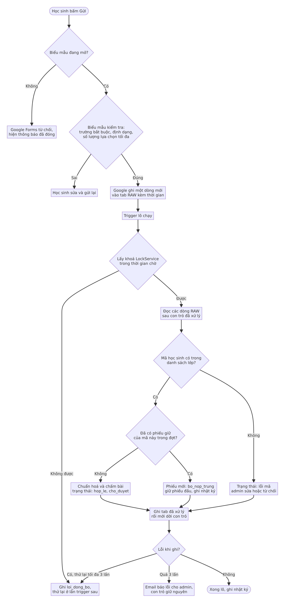

# T4. Mô hình hệ sinh thái thu thập và quản lý dữ liệu (bản đề xuất để duyệt)

Trạng thái: ĐỀ XUẤT, chưa triển khai, chờ Truong duyệt. Ngày soạn: 03/11/2026.
Phạm vi: thu thập đăng ký và thi tuyển CLB, quản lý dữ liệu, duyệt, xuất sang kiosk RB-DA.

> **Hai hạn chế của bản này (đọc trước).**
> 1. Phiên soạn bị chính sách mạng chặn nên **không mở được trang tham khảo của giáo viên** (`magenta-crepe-416060.netlify.app/dang-ky-clb`). Phần "hiện trạng" dựa trên mã và skill có sẵn trong kho, không dựa trên trang đó. Xem mục 2.2 và mục 15.
> 2. Không mở được trang hạn mức chính thức của Google, Microsoft, Supabase. Mọi con số hạn mức và giá đều lấy từ **tóm tắt kết quả tìm kiếm** và mang nhãn **CHƯA XÁC MINH**. Thiết kế được chọn sao cho vẫn đứng vững nếu các số sai lệch 2 lần (mục 9.3). Không có con số nào trong tài liệu được khẳng định là đã đo.

Nhãn dùng xuyên suốt: **TT-CXM** = "CHƯA XÁC MINH (tóm tắt tìm kiếm, 03/11/2026)". Mỗi con số mang nhãn này kèm đường dẫn chính thức cần kiểm.

---

## 1. Tóm tắt điều hành (khuyến nghị trong 10 dòng)

1. Chọn **Phương án 1: Google** (Forms, Sheets, Apps Script, Drive). Chi phí 0 đồng, không có máy chủ, quản trị viên không cần kỹ thuật.
2. **Một Google Sheets cho mỗi đợt đăng ký**, đóng vai cơ sở dữ liệu duy nhất. Trong đó có tab RAW (câu trả lời gốc, chỉ thêm, không sửa) và các tab đã xử lý (phiếu, nguyện vọng, bài thi, nhật ký).
3. **Apps Script chạy theo lô** (trigger 15 phút khi đang mở, 5 phút trong cửa sổ đỉnh, 1 giờ khi đóng), dời con trỏ chỉ sau khi ghi thành công, nên không mất và không nhân đôi phiếu khi lỗi hoặc chạy lại.
4. Bảng điều khiển là **chính Sheets** có menu tuỳ biến: lọc, duyệt hàng loạt, sửa, nhật ký. Chưa dựng web riêng trong V1.
5. Hai vai trò: **Submitter** (chỉ điền biểu mẫu) và **Administrator** (người sửa Sheets, 1 đến 2 người).
6. Đầu ra giữ nguyên **hợp đồng hiện có**: tab xuất tương thích `RAW_PHIEU.xlsx`, rồi skill `xu-li-raw-forms` ra `SO_NHAP_CLB.xlsx` (đã có cột Lớp) nạp vào kiosk ngoại tuyến. Không đổi hợp đồng CSV.
7. Việc quan trọng (chốt đợt, loại phiếu) cần **admin xác nhận trong hộp thoại** và được ghi vào nhật ký.
8. **Ngưỡng chuyển sang Supabase đo được** (mục 10), không chuyển theo cảm tính. Phương án 2 (Microsoft) không được chọn vì Power Apps và Dataverse cần gói trả tiền.
9. Số liệu hạn mức đều CHƯA XÁC MINH. Việc đầu tiên khi mạng mở: kiểm các trang ở mục 16.
10. Việc cần Truong quyết trước khi làm: mục 14 (câu hỏi mở), đặc biệt trường dùng Google Workspace for Education hay Gmail thường, và học sinh có tài khoản Google hay không.

---

## 2. Hiện trạng và trang tham khảo

### 2.1 Hiện trạng trong kho (đã đọc)

Quy trình hiện nay, theo skill `tao-google-form-clb`, `xu-li-raw-forms` và `mau_forms_thi_clb/DINH_DANG_RAW.md`:

| Bước | Công cụ | Ghi chú |
|---|---|---|
| Dựng biểu mẫu | `TAO_GOOGLE_FORM.gs` (Apps Script) | Top 1 đến Top 10 dạng danh sách thả xuống, tick tối đa 5 CLB thi, chỉ hiện đề CLB đã chọn, tự chấm |
| Thu thập | Google Forms | Học sinh nộp, Google lưu câu trả lời |
| Xuất raw | Hàm `chamTheoCLB` | Ra `RAW_PHIEU.xlsx` (dạng dài, mỗi câu một dòng, 19 cột) và `DAP_AN.xlsx` trong thư mục Drive "Kết quả CLB ..." |
| Xử lý | `xu_li_raw.py` chạy trên máy | Chấm lại, giữ phiếu đầu của mỗi mã, soát bất thường, ra `SO_NHAP_CLB.xlsx` và `BAO_CAO_BAT_THUONG.md` |
| Nạp | Kiosk RB-DA | Nạp sổ nhập, chạy xếp |

Khoảng trống của quy trình hiện nay (suy ra từ mã, không phải từ trang tham khảo):
- Phải **sao chép tay** thư mục Drive về máy rồi chạy lệnh; không có bảng theo dõi trạng thái.
- Không có nơi để **duyệt, từ chối, sửa** từng phiếu; chỉ có báo cáo văn bản.
- Không có **nhật ký thay đổi**; không có thông báo khi có phiếu lỗi.
- Một biểu mẫu cho một đợt; **nhiều đối tượng và nhiều đợt** chưa có khung quản lý.
- `RAW_PHIEU` dạng dài làm số ô tăng nhanh (xem mục 9.2).
- Không có kiểm tra mã học sinh theo **danh sách lớp** trước khi nhận (chỉ kiểm dạng mã khi xử lý).

### 2.2 Trang tham khảo của giáo viên: KHÔNG MỞ ĐƯỢC

Địa chỉ `https://magenta-crepe-416060.netlify.app/dang-ky-clb` bị chính sách mạng của môi trường chặn (HTTP 403 ở bước CONNECT; `read_documentation` mục `environment.network` hướng dẫn cho phép host). Không có nội dung nào của trang được đọc. **Không suy đoán** trường, luồng hay giao diện của trang đó.

Đối chiếu trang tham khảo (làm khi mở được mạng), danh sách việc:

| # | Việc cần kiểm | Dùng để quyết |
|---|---|---|
| 1 | Liệt kê các trang con, nút, menu | Có phần quản trị hay chỉ có biểu mẫu |
| 2 | Từng trường: nhãn, kiểu (chữ, số, email, thả xuống, nhiều lựa chọn, tải tệp), bắt buộc hay không | So với yêu cầu loại trường ở mục 4 |
| 3 | Kiểm tra đầu vào: định dạng mã, trùng mã, giới hạn số lựa chọn | So với mục 8 (xác thực, bỏ trùng) |
| 4 | Dữ liệu gửi đi đâu (Google Forms nhúng, Netlify Forms, API riêng, Google Sheets) | Quyết có tận dụng được hay phải thay |
| 5 | Có chặn nộp khi đóng, có giờ mở đóng không | So với mở đóng theo giờ |
| 6 | Xác nhận sau khi nộp, có cho sửa phiếu không | Luồng người nộp |
| 7 | Có tài khoản, đăng nhập, hay ẩn danh | Vai trò và chống trùng |
| 8 | Chạy trên điện thoại ra sao, tốc độ tải | Đỉnh tải và trải nghiệm |
| 9 | Chỗ lưu trữ và quota của dịch vụ đó (Netlify free: băng thông, số lần gửi biểu mẫu) | Chi phí khi lên 10.000 người nộp |
| 10 | Điểm tốt đáng giữ lại (giao diện, chữ, bố cục) | "Nâng cấp trên nền cái cũ" |

Nếu trang là biểu mẫu tĩnh trên Netlify, câu hỏi then chốt là mục 4 và 9: nơi lưu câu trả lời và hạn mức gửi biểu mẫu. Chưa thể kết luận.

---

## 3. Giả định quy mô (giả định thiết kế, không phải số đo)

Tách bốn đại lượng, không lẫn lộn:

| Đại lượng | Giả định thiết kế | Cách dùng |
|---|---|---|
| Tổng số người dùng đã đăng ký (có thể nộp) | 2.000 đến 10.000 người mỗi chu kỳ | Cỡ danh sách học sinh `hoc_sinh` |
| Tổng số phiếu nộp mỗi chu kỳ | Gần bằng số người, cộng phiếu nộp lại (giả định tối đa 1,3 phiếu mỗi người, tức tối đa 13.000) | Cỡ tab RAW, cỡ tab `phieu` |
| Số phiếu nộp đồng thời lúc đỉnh | Giả định 1 đến 3% số người nộp trong cùng một phút mở và đóng, tức 100 đến 300 phiếu trong phút đỉnh khi 10.000 người. **Không** giả định 10.000 cùng lúc | Quyết việc phải dựa vào bộ đệm của Google Forms, không dùng Apps Script trên đường nộp |
| Khối lượng xử lý hằng ngày | Xử lý theo lô: tối đa vài nghìn dòng mới mỗi lô, mỗi lô dưới 1 đến 2 phút | Quyết ngân sách thời gian trigger |

Người dùng: học sinh, giáo viên (Submitter), 1 đến 2 quản trị viên. Cao điểm: lúc mở và lúc sắp đóng. Nhiều chu kỳ: mỗi chu kỳ một Sheets mới, chu kỳ cũ được lưu trữ.

---

## 4. Ánh xạ yêu cầu sang thành phần

| Yêu cầu | Thành phần V1 | Ghi chú |
|---|---|---|
| 1. Tạo và quản lý biểu mẫu | Google Forms sinh bằng `TAO_GOOGLE_FORM.gs` (đã có); tab `ky_dang_ky` ghi mỗi biểu mẫu | Khung có sẵn |
| 1. Nhiều đối tượng, nhiều đợt | Cột `doi_tuong` và `ky_id` trong `ky_dang_ky`; mỗi đợt một biểu mẫu và một Sheets | Đối tượng: khối lớp, lớp thử, giáo viên |
| 1. Loại trường: chữ, số, email, thả xuống, nhiều lựa chọn, tải tệp | Google Forms hỗ trợ sẵn các loại này (chữ ngắn, đoạn, thả xuống, tick, lưới, tải tệp). Tải tệp bắt buộc đăng nhập Google: TT-CXM, xem mục 14 | Tải tệp hoãn sang sau V1 trừ khi cần |
| 1. Mở, đóng biểu mẫu | Trigger theo giờ gọi `setAcceptingResponses` và đặt thông báo đã đóng | Cần kiểm tên hàm khi mạng mở |
| 1. Kiểm tra đầu vào | Kiểm tra biểu mẫu (bắt buộc, regex mã, số lựa chọn) cộng kiểm tra lô (mã có trong `hoc_sinh`) | Mục 8 |
| 1. Hạn chế trùng | Bỏ trùng trong lô theo mã học sinh, giữ phiếu đầu (đã là luật của `xu-li-raw-forms`); tuỳ chọn một phiếu mỗi tài khoản | Mục 8 |
| 2. Kho trung tâm | Một Sheets mỗi đợt, nhiều tab | Mục 6 |
| 2. Tìm, lọc, sửa | Bộ lọc Sheets, chế độ xem lọc, tab điều khiển | |
| 2. Xuất Excel và CSV | Menu "Xuất"; tải .xlsx và .csv của Sheets | |
| 3. Bảng điều khiển | Tab `dieu_khien` (đếm theo trạng thái) + menu tuỳ biến + hộp thoại | Không dựng web riêng ở V1 |
| 3. Duyệt, từ chối, sửa | Cột `trang_thai_duyet` dạng thả xuống, menu "Duyệt các dòng đã chọn" | Mục 7 |
| 3. Phân quyền | Chỉ 2 vai trò: Submitter (không có quyền vào Sheets), Administrator (người sửa) | Mục 6.3 |
| 3. Lịch sử thay đổi và quyết định | Tab `nhat_ky` chỉ thêm dòng | Ghi trước và sau |
| 4. Tự đồng bộ | Trigger theo thời gian, xử lý theo lô, có con trỏ | Mục 7.1 |
| 4. Tự động hoá việc lặp, ít sao chép | Mở đóng tự động, chuẩn hoá tự động, xuất tự động | |
| 4. Thông báo dữ liệu mới và lỗi | `MailApp` gửi bản tóm tắt; báo lỗi trigger của Apps Script | Hạn mức email: TT-CXM |
| 4. Người duyệt cho quyết định quan trọng | Chốt đợt bắt buộc xác nhận trong hộp thoại; nhật ký ghi người và lúc | |
| 5. Xuất cho phần mềm khác | Tab `xuat_raw_phieu` (cột đúng `DINH_DANG_RAW.md`) và `xuat_so_nhap` | Mục 11 |
| 5. API hoặc tích hợp | V1: tệp (kiosk ngoại tuyến nên tệp là đúng). Sau V1: `doGet` trả JSON có mã | Hoãn |
| 5. Cấu trúc nhất quán | Tên bảng và cột cố định (mục 6), bản chuyển sang Supabase giữ nguyên | |

---

## 5. So sánh ba phương án

Mọi con số hạn mức: TT-CXM, kiểm theo cột "Nguồn chính thức cần kiểm". Không có con số nào được tự bịa; chỗ không có số thì ghi "chưa tìm được".

| Tiêu chí | 1. Google (Forms, Sheets, Apps Script, Drive) | 2. Microsoft (Forms, Power Automate, SharePoint, Excel, Power Apps) | 3. Tự dựng nhẹ (web tĩnh + Supabase + backend tối thiểu) |
|---|---|---|---|
| Giới hạn miễn phí thực tế (TT-CXM) | Trigger: 90 phút mỗi ngày với tài khoản thường, 6 giờ với Workspace; mỗi lần chạy tối đa 6 phút; 20 trigger mỗi người mỗi script; 30 thực thi đồng thời mỗi người, 1.000 mỗi script. Sheets: trần 10 triệu ô (một nguồn nói 20 triệu, chưa kiểm). Forms: không có trần số phiếu cố định, trần thực tế do Sheets nối kèm (một báo cáo lẻ nói Sheets nối ngừng nhận ở khoảng 100.000 phiếu) | Trình kích hoạt Forms: tối đa 300 lệnh gọi mỗi kết nối trong 60 giây (nguồn tài liệu connector); Power Automate gói miễn phí hoặc kèm Microsoft 365 chỉ dùng connector chuẩn, luồng tự tắt sau 90 ngày không kích hoạt (nguồn cộng đồng); trần số phản hồi Forms: nguồn thứ ba nói 200 (cá nhân miễn phí) đến 5.000.000 (gói công việc, giáo dục). Hạn mức hành động mỗi ngày: chưa tìm được | Supabase gói miễn phí: 500 MB cơ sở dữ liệu, 5 GB egress, 1 GB tệp, 50.000 MAU, tối đa 2 dự án hoạt động, tạm dừng sau 1 tuần không hoạt động, không có sao lưu tự động. Pro 25 đô mỗi tháng |
| Chi phí khi ở quy mô 10.000 người | Dự kiến 0 đồng nếu dùng tài khoản Google sẵn có | 0 đồng với connector chuẩn; Dataverse, Power Apps, connector cao cấp cần gói trả tiền (không chọn) | 0 đồng nếu chịu rủi ro tạm dừng và không sao lưu; cần Pro (25 đô mỗi tháng) nếu cần sao lưu và không tạm dừng, vi phạm ưu tiên chi phí thấp |
| Xử lý đỉnh tải | Google Forms hấp thụ lượng nộp; Apps Script chỉ xử lý sau, theo lô, không nằm trên đường nộp. Rủi ro chính: số thực thi đồng thời và khoá | Forms hấp thụ; luồng Power Automate kích hoạt từng phiếu dễ bị giới hạn tốc độ khi đỉnh | Phải tự bảo đảm: trang web tĩnh tốt, nhưng ghi vào cơ sở dữ liệu cần giới hạn kết nối; không đo được ở đây |
| Toàn vẹn dữ liệu | Raw chỉ thêm do Google ghi; bảo vệ tab, nhật ký; trùng xử lý ở lô. Sheets không có ràng buộc khoá ngoại, phải tự kiểm | SharePoint Lists có kiểu cột; Excel online tương tự Sheets | Mạnh nhất: ràng buộc khoá, giao dịch, ràng buộc duy nhất ngay ở cơ sở dữ liệu |
| Bảo mật | Chia sẻ theo email; biểu mẫu có thể giới hạn theo tên miền nếu dùng Workspace (TT-CXM). Không dữ liệu nhạy cảm đặc biệt | Theo thuê bao Microsoft 365 của trường nếu có (chưa biết) | Phải tự cấu hình đăng nhập, quy tắc truy cập (RLS), khoá API; sai sót cấu hình là rủi ro |
| Bảo trì | Gần như không có máy chủ; rủi ro: Google đổi hạn mức hoặc giao diện | Tuỳ có tenant Microsoft 365 giáo dục hay không; Power Apps và Dataverse phức tạp | Cao nhất: mã, triển khai, nâng cấp, theo dõi tạm dừng; admin không kỹ thuật khó tự xử lý |
| Tích hợp với kiosk | Tệp Excel và CSV, đúng hợp đồng hiện có; skill `xu-li-raw-forms` dùng nguyên | Xuất Excel được, cần viết lại phần xử lý raw cho định dạng Microsoft Forms | Xuất được qua API, cần viết trình xuất; thuận cho V2 |
| Nguồn chính thức cần kiểm | `developers.google.com/apps-script/guides/services/quotas`; `developers.google.com/workspace/sheets/api/limits`; `developers.google.com/apps-script/reference/lock/lock-service`; trang giới hạn của Google Sheets trên `support.google.com` | `learn.microsoft.com/en-us/power-automate/limits-and-config`; `learn.microsoft.com/en-us/connectors/microsoftforms/`; trang giới hạn SharePoint | `supabase.com/pricing`; `supabase.com/docs/guides/platform/billing-on-supabase`; trang quota của dịch vụ lưu trữ web tĩnh (Netlify, chưa nhắm) |

Kết luận so sánh: Phương án 1 đáp ứng ưu tiên (chi phí, ít quản trị, ít bảo trì, không máy chủ) với số lượng việc phải tự viết ít nhất, vì **đã có sẵn** `TAO_GOOGLE_FORM.gs` và `xu_li_raw.py`. Phương án 3 là hướng chuyển khi chạm ngưỡng ở mục 10. Phương án 2 bị loại vì phần quản lý duyệt cần Power Apps hoặc Dataverse có phí, và vì trường chưa rõ có tenant Microsoft 365 hay không.

Biểu đồ: [anh/e_chuyen_doi.png](anh/e_chuyen_doi.png) (ngưỡng chuyển đổi).

---

## 6. Kiến trúc được chọn và mô hình dữ liệu

Biểu đồ kiến trúc: 

### 6.1 Nguyên tắc

- **Một cơ sở dữ liệu** là một Google Sheets cho mỗi đợt. Không có nhiều kho song song.
- **Lớp Raw**: tab do Google Forms tạo ra. Có mã `raw_id`, thời gian, nội dung gốc. Chỉ thêm, **không sửa, không xoá**. Tab được bảo vệ ở mức cảnh báo; Apps Script không có đường ghi vào tab này.
- **Lớp Processed**: các tab đã chuẩn hoá, có trạng thái xử lý và trạng thái duyệt, có khoá liên kết về Raw.
- Mọi sửa của admin chỉ xảy ra ở lớp Processed và có dòng trong `nhat_ky`.

### 6.2 Mô hình dữ liệu (tab, cột, khoá, trạng thái)

Biểu đồ quan hệ: 

| Tab | Cột chính | Khoá | Ghi chú |
|---|---|---|---|
| `ky_dang_ky` | ky_id, ten, doi_tuong, mo, dong, trang_thai, form_id | PK ky_id | Một dòng mỗi đợt và đối tượng. trang_thai: `nhap`, `mo`, `dong`, `da_chot`, `luu_tru` |
| `RAW` (tab của Forms) | raw_id, ky_id, so_dong, thoi_gian, nội dung các câu | PK raw_id = ky_id + "-" + số dòng | Số dòng không bao giờ bị chèn hay xoá, nên ổn định. Nếu API cho lấy mã phản hồi của Forms thì thêm cột mã đó (cần kiểm khi mạng mở) |
| `hoc_sinh` | student_id, ho_ten, lop, email | PK student_id | Danh sách lớp do admin nhập. Dùng để kiểm mã và lấy Lớp. Dữ liệu thật của học sinh: không đưa vào kho mã |
| `clb` | club_id, ten, buoi, chi_tieu | PK club_id | Chỉ tiêu do nhà trường lập |
| `phieu` | phieu_id, raw_id, ky_id, student_id, thoi_gian, trang_thai_xu_ly, trang_thai_duyet, ban_giu, ghi_chu, nguoi_duyet, thoi_gian_duyet | PK phieu_id; FK raw_id, ky_id, student_id | Một dòng mỗi phiếu. Dạng rộng, nhỏ hơn nhiều so với RAW_PHIEU dạng dài |
| `nguyen_vong` | phieu_id, buoi, hang, club_id | PK (phieu_id, buoi, hang) | Một dòng mỗi nguyện vọng |
| `bai_thi` | phieu_id, club_id, buoi, diem, duoc_tinh | PK (phieu_id, club_id) | Điểm thang 10, tính lại theo đáp án gốc như `xu_li_raw.py` |
| `nhat_ky` | log_id, thoi_gian, nguoi, hanh_dong, doi_tuong_id, truoc, sau, ly_do | PK log_id | Chỉ thêm. Ghi cả hành động tự động |
| `loi_dong_bo` | id, thoi_gian, buoc, chi_tiet, so_lan_thu, trang_thai | PK id | Lỗi của lô, số lần thử |
| `cau_hinh` | khoá, giá trị | PK khoá | Con trỏ `raw_da_xu_ly_den`, chu kỳ trigger, địa chỉ email thông báo |
| `dieu_khien` | Công thức đếm theo trạng thái | không | Bảng điều khiển |
| `xuat_raw_phieu`, `xuat_so_nhap` | Cột đúng hợp đồng (mục 11) | không | Sinh lại khi chốt đợt |

Trạng thái:

| Trường | Giá trị | Ý nghĩa |
|---|---|---|
| `trang_thai_xu_ly` | `moi`, `hop_le`, `canh_bao`, `loi`, `bo_nop_trung`, `bo_khong_ma` | Kết quả chuẩn hoá và kiểm tra. Hai giá trị cuối trùng tên với `trang_thai_phieu` của `RAW_PHIEU` |
| `trang_thai_duyet` | `cho_duyet`, `da_duyet`, `tu_choi` | Do admin quyết. Mặc định `cho_duyet` |
| `ban_giu` | 1 hoặc 0 | 1 là phiếu giữ của mã trong đợt |
| `ky_dang_ky.trang_thai` | `nhap`, `mo`, `dong`, `da_chot`, `luu_tru` | `da_chot` khoá đợt |

### 6.3 Vai trò và bảo mật

- **Submitter**: chỉ có đường dẫn biểu mẫu. Không có quyền vào Sheets.
- **Administrator**: 1 đến 2 người được chia sẻ quyền sửa Sheets. Không có vai trò thứ ba.
- Tab RAW và `nhat_ky`: bảo vệ ở mức cảnh báo khi sửa; Apps Script chỉ thêm dòng vào `nhat_ky`.
- Việc đăng nhập bắt buộc của biểu mẫu và việc giới hạn theo tên miền: TT-CXM, xem câu hỏi mở số 1 và 2.

---

## 7. Luồng xử lý

### 7.1 Luồng nộp phiếu, kiểm tra, bỏ trùng, thử lại

Điểm thiết kế:
- Đường nộp chỉ gồm Google Forms và việc Google ghi vào tab RAW, **không** có Apps Script trên đường nộp, nên đỉnh tải do Forms hấp thụ.
- Lô đọc các dòng RAW sau con trỏ `raw_da_xu_ly_den`, ghi tab đã xử lý **rồi mới dời con trỏ**. Chạy lại không nhân đôi vì phiếu có khoá `raw_id` và lô bỏ qua `raw_id` đã có.
- `LockService` (khoá script) bảo đảm hai lô không chạy chồng. Lấy khoá thất bại thì ghi `loi_dong_bo` và để lần trigger sau thử lại. Khoá chặn mọi lần chạy bất kể ai kích hoạt (nguồn: tóm tắt trang tham chiếu LockService, TT-CXM).
- Thử lại tối đa 3 lần mỗi lô, quá 3 lần thì email admin và giữ nguyên con trỏ.
- Chọn mức 3 lần là quyết định thiết kế, chưa dựa trên số liệu.

### 7.2 Luồng duyệt của admin và xuất sang kiosk

Điểm thiết kế:
- Duyệt hàng loạt cho nhóm hợp lệ; lỗi và cảnh báo xử lý riêng, **bắt buộc ghi lý do** khi từ chối hoặc sửa.
- **Chốt đợt** là quyết định quan trọng duy nhất cần người duyệt: hộp thoại hiện số phiếu duyệt, từ chối và số CLB thiếu chỉ tiêu trước khi khoá.
- Sau chốt đợt, đợt khoá. Muốn mở lại phải do admin làm và có dòng nhật ký.

---

## 8. Độ tin cậy

| Rủi ro | Biện pháp |
|---|---|
| Mất phiếu thầm lặng | RAW do Google ghi, chỉ thêm. Có chỉ số đối soát: số dòng RAW bằng số phiếu đã xử lý cộng số lỗi. Lệch thì cảnh báo |
| Nhân đôi phiếu | `raw_id` là khoá duy nhất; mã học sinh trùng giữ phiếu đầu, phiếu sau mang `bo_nop_trung` (luật đã có trong `xu_li_raw.py`) |
| Hỏng dữ liệu | Lớp Raw không sửa; chỉnh sửa ở lớp Processed có nhật ký trước và sau |
| Nộp đồng thời | Forms tuần tự hoá việc ghi; lô dùng `LockService` |
| Vượt hạn mức tự động hoá | Ngân sách thiết kế mục 9.3; theo dõi mức dùng trong `loi_dong_bo` |
| Đồng bộ lỗi | Thử lại, con trỏ chỉ dời khi ghi xong, email báo |
| Nhất quán | Mỗi lô ghi theo thứ tự: tab đã xử lý, nhật ký, rồi con trỏ |
| Sao lưu và khôi phục | Trigger hằng ngày chép Sheets vào thư mục Drive riêng, giữ 14 bản (con số 14 là thiết kế); khi đang mở hoặc sát đóng thì mỗi giờ. Chốt đợt thì chép thêm một bản gắn nhãn không xoá |
| Chỉnh nhầm tab RAW | Khôi phục từ bản sao gần nhất, hoặc dựng lại tab đã xử lý từ RAW (lô có thể chạy lại từ đầu) |

Xử lý nặng làm theo **lô**, không theo từng phiếu.

---

## 9. Hạn mức, kích cỡ và biên an toàn

### 9.1 Bảng hạn mức và nguồn

Tất cả: **Trạng thái nguồn = CHƯA XÁC MINH (tóm tắt tìm kiếm, 03/11/2026)**. Ngày truy xuất: 03/11/2026 (qua kết quả tìm kiếm, không phải đọc trang gốc).

| Hạn mức | Số liệu trong tóm tắt | Nguồn chính thức cần kiểm | Nguồn trong kết quả tìm kiếm |
|---|---|---|---|
| Apps Script: thời gian một lần chạy | 6 phút | `developers.google.com/apps-script/guides/services/quotas` | `developers.google.com/apps-script/quotas` |
| Apps Script: tổng thời gian trigger mỗi ngày | 90 phút (tài khoản thường), 6 giờ (Workspace) | như trên | như trên |
| Apps Script: trigger mỗi người mỗi script | 20 | như trên | như trên |
| Apps Script: thực thi đồng thời | 30 mỗi người, 1.000 mỗi script | như trên | như trên |
| Sheets API: đọc và ghi mỗi phút | 300 đọc, 300 ghi mỗi dự án; 60 đọc, 60 ghi mỗi người mỗi dự án; quá thì lỗi 429; nhiều nguồn nói tương lai có thể tính phí. V1 dùng `SpreadsheetApp`, không dùng API này nên chưa phụ thuộc | `developers.google.com/workspace/sheets/api/limits` | `developers.google.com/sheets/api/limits` |
| Google Sheets: trần ô | 10 triệu (thông báo năm 2022); một nguồn nói 20 triệu, chưa kiểm | trang giới hạn của Google Sheets trên `support.google.com` (chưa biết địa chỉ chính xác) | `workspaceupdates.googleblog.com/2022/03/ten-million-cells-google-sheets.html` |
| Google Forms nối Sheets | Báo cáo lẻ: ngừng nhận ở khoảng 100.000 phiếu. Một người viết, chưa kiểm | trang trợ giúp Google Forms | `blog.g-gen.co.jp/entry/limit-for-google-forms-spreadsheet-sync` (nguồn thứ ba) |
| LockService | `waitLock` báo lỗi khi hết thời gian chờ, `tryLock` trả về false. `getDocumentLock()` có thể trả null trong web app độc lập, dùng khoá script. Ví dụ chính thức dùng chờ 30 giây. Chưa thấy trần thời gian khoá | `developers.google.com/apps-script/reference/lock/lock-service` | cùng trang (tìm kiếm) |
| Email `MailApp` mỗi ngày | Chưa tìm được | trang quota Apps Script | không có |
| Microsoft Forms connector | 300 lệnh gọi mỗi kết nối trong 60 giây; một nguồn nói chu kỳ thăm trigger 86.400 giây (nghi ngờ, chưa kiểm) | `learn.microsoft.com/en-us/connectors/microsoftforms/` | cùng trang |
| Power Automate gói miễn phí | Luồng tắt sau 90 ngày không kích hoạt (nguồn cộng đồng); hạn mức hành động mỗi ngày: chưa tìm được | `learn.microsoft.com/en-us/power-automate/limits-and-config` | `powerusers.microsoft.com` (diễn đàn, không chính thức) |
| Microsoft Forms số phản hồi | 200 đến 5.000.000 tuỳ gói (nguồn thứ ba) | trang Microsoft Forms hỗ trợ | `gappsy.com/tools/microsoft-forms/` |
| Supabase miễn phí | 500 MB cơ sở dữ liệu, 5 GB egress, 1 GB tệp, 50.000 MAU, 2 dự án hoạt động, tạm dừng sau 1 tuần không hoạt động, không sao lưu tự động | `supabase.com/pricing`; `supabase.com/docs/pricing` | cùng trang (qua tìm kiếm) |
| Supabase Pro | 25 đô mỗi tháng; 8 GB đĩa; 250 GB băng thông (một nguồn thứ ba nói 50 GB, mâu thuẫn); sao lưu hằng ngày giữ 7 ngày | như trên | như trên |

Ghi chú quan trọng: Google nói hạn mức "có thể đổi hoặc bỏ bất cứ lúc nào, không báo trước" (theo tóm tắt, TT-CXM).

### 9.2 Ước tính cỡ dữ liệu (tính từ định dạng, không đo)

- `RAW_PHIEU` dạng dài, 19 cột. Giả sử mỗi phiếu tạo khoảng 30 dòng (thông tin, đăng ký buổi, xếp hạng, chọn thi, bài thi). Với 10.000 phiếu: khoảng 300.000 dòng, tức khoảng 5,7 triệu ô. Con số 30 dòng là **giả định**, kiểm bằng phiếu thật mẫu.
- Hệ quả: nếu để tab RAW dạng dài trong cùng Sheets với các tab xử lý, có thể chạm nửa trần 10 triệu ô. Vì vậy:
  - Tab RAW của Forms là **dạng rộng** (một dòng mỗi phiếu), tức khoảng 13.000 dòng nhân vài chục cột, vài trăm nghìn ô.
  - Dạng dài `RAW_PHIEU` chỉ được sinh ra ở tab xuất khi chốt đợt, hoặc tách thành tệp riêng, không giữ lâu.
  - Mỗi đợt một Sheets, lưu trữ sau khi chốt.

### 9.3 Biên an toàn trước sai số 2 lần

Quy tắc: thiết kế dùng không quá **một phần ba** hạn mức thấp nhất nghe được, nên nếu hạn mức thật chỉ bằng nửa vẫn còn dư.

| Hạn mức (số trong tóm tắt) | Mức dùng thiết kế | Còn dư nếu hạn mức thật bằng một nửa |
|---|---|---|
| Trigger 90 phút mỗi ngày | Không quá 30 phút mỗi ngày (cao điểm), thường dưới 5 phút | Nửa là 45 phút, vẫn đủ |
| 6 phút mỗi lần chạy | Mỗi lô không quá 2 phút; vượt thì dừng sớm và để lô sau xử lý tiếp (xử lý theo khối cố định) | Nửa là 3 phút, vẫn đủ |
| 20 trigger mỗi script | Dùng không quá 5 trigger (lô, sao lưu, mở và đóng) | Nửa là 10, vẫn đủ |
| Trần ô 10 triệu | Mục tiêu không quá 3 triệu ô mỗi Sheets | Nửa là 5 triệu, vẫn đủ |
| Đồng thời | Không có xử lý song song; một khoá script, tối đa 1 lô chạy | Không phụ thuộc |

Chu kỳ trigger: 15 phút khi biểu mẫu đang mở, 5 phút chỉ trong cửa sổ đỉnh cấu hình sẵn (ví dụ 2 giờ đầu và 2 giờ cuối), 60 phút khi đóng mà chưa chốt, không chạy sau khi chốt. Tính thử với giả định mỗi lô 30 giây (giả định, chưa đo): 10 giờ mở thường mỗi 15 phút là 40 lần, 4 giờ đỉnh mỗi 5 phút là 48 lần, tổng 88 lần, khoảng 44 phút. Con số này vượt mức 30 phút của bảng trên, nên cửa sổ đỉnh phải ngắn hơn (tổng 2 giờ, 24 lần): 40 + 24 = 64 lần, khoảng 32 phút, tạm chấp nhận. Mọi con số này phụ thuộc thời gian lô thật, phải đo ở đợt thử (mục 12).

---

## 10. Ngưỡng chuyển đổi đo được (từ Sheets sang Supabase)

| # | Ngưỡng | Cách đo |
|---|---|---|
| 1 | Độ trễ đồng bộ p95 quá 30 phút, 3 ngày liên tiếp | Mỗi lô ghi `thoi_gian_nop` và `thoi_gian_xu_ly` vào `loi_dong_bo` hoặc tab số đo; tính p95 |
| 2 | Thời gian trigger dùng quá 50% hạn mức đã xác minh | Trang Executions của Apps Script cộng thời gian mỗi ngày |
| 3 | Lỗi khoá hoặc lỗi 429 quá 1% số lần chạy lô | Đếm trong `loi_dong_bo` |
| 4 | Tab xử lý quá 50% giới hạn ô, hoặc bảng điều khiển tải quá 10 giây | Đếm ô; đo bằng đồng hồ với 10.000 dòng |
| 5 | Cần truy vấn quan hệ nhiều bảng mà bộ lọc và công thức không làm nổi | Ghi yêu cầu thật của admin; hai lần liên tiếp thì tính |

Trước khi chuyển: thử biện pháp rẻ (lô nhỏ hơn, tách Sheets theo khối lớp, lưu trữ đợt cũ). Chuyển V2 chỉ khi vẫn vượt sau một đợt đo lại. V2 giữ **nguyên tên bảng và tên cột** của mục 6.2.

Ngưỡng 30 phút, 50%, 1%, 10 giây là quyết định thiết kế để Truong duyệt, chưa dựa trên số đo.

---

## 11. Đầu ra và tích hợp với kiosk

Hợp đồng cột đang dùng (CLAUDE.md, bất biến 7): `club_id, student_id, test_club_k, score_k, pref_k, <buoi>_pref_k`, cùng Lớp (cột Lớp đã có trong `so_nhap.py`, nhãn tiếng Việt "Lớp", bí danh `lop`, `class`, theo mục A14). V1 **không đổi hợp đồng**.

| Đầu ra | Cách tạo | Dùng cho |
|---|---|---|
| `xuat_raw_phieu` (tab và `RAW_PHIEU.xlsx`) | Chỉ phiếu `da_duyet` và `ban_giu = 1`, cột đúng `DINH_DANG_RAW.md` (19 cột) | Skill `xu-li-raw-forms` dùng nguyên, không sửa |
| `DAP_AN.xlsx` | Tệp đáp án sẵn có từ biểu mẫu | như trên |
| `xuat_so_nhap` | Hoãn sang sau V1 (bản V1 do skill ra `SO_NHAP_CLB.xlsx`) | Nạp thẳng vào kiosk |
| CSV | "Tải xuống" từ Sheets | Phần mềm khác |

Lý do giữ `RAW_PHIEU`: tận dụng skill đã có test (`tests/test_skill_xu_li_raw.py`), không viết lại phần chấm và soát. Phiếu bị admin từ chối **không** vào `xuat_raw_phieu`, và lần xuất ghi vào `nhat_ky`.

Vì kiosk chạy ngoại tuyến nên giao tiếp bằng tệp là đúng bản chất. API (`doGet` trả JSON có mã) thuộc mục "hoãn".

---

## 12. Mục tiêu hiệu năng và cách kiểm

Các số dưới đây là **mục tiêu đề xuất**, không phải kết quả. Chưa có số nào đạt được hay đo được.

| Chỉ số | Mục tiêu đề xuất | Cách kiểm |
|---|---|---|
| Tỷ lệ nộp thành công | Từ 99,9% trở lên (phiếu bấm Gửi thành công và có dòng trong RAW) | Chạy đợt thử với biểu mẫu thử, nhiều thiết bị, so số bấm Gửi với số dòng RAW. Không bắn tải giả vào biểu mẫu thật |
| Độ trễ đồng bộ (nộp đến vào tab xử lý), p95 | Không quá 20 phút khi biểu mẫu mở (chu kỳ 15 phút cộng thời gian lô) | Đồng hồ trong mỗi lô, tính p95 trên đợt thử |
| Tải bảng điều khiển | Không quá 5 giây với 10.000 phiếu | Dựng Sheets thử có 13.000 dòng dữ liệu tổng hợp rồi mở bằng trình duyệt, đo 5 lần |
| Thời gian xuất | Không quá 2 phút cho 10.000 phiếu | Đo từ lúc bấm Chốt đợt đến lúc có tệp |
| Tỷ lệ lô tự động thất bại | Dưới 1% số lần chạy; không có lỗi nào bị bỏ sót thông báo | Đếm `loi_dong_bo` so với tổng lần chạy trên trang Executions |
| RPO (mất dữ liệu tối đa) | 1 giờ khi đang mở, 24 giờ khi nghỉ. Riêng RAW do Google lưu giữ nên không mất nếu chưa có người xoá | Kiểm tuổi bản sao lưu mới nhất |
| RTO (khôi phục) | 4 giờ làm việc | Diễn tập một lần: giả vờ hỏng Sheets, khôi phục từ bản sao, dựng lại tab xử lý từ RAW, đo thời gian |

Kiểm đỉnh tải: giả lập 100 đến 300 phiếu trong một phút bằng nhiều người thật hoặc biểu mẫu thử riêng, kiểm cả chỗ ghi RAW lẫn lô sau đó. Khả năng chịu tải thực của Google Forms: chưa xác minh; kiểm trong đợt thử trước khi mở thật.

---

## 13. Danh sách V1, để sau, và không làm

### 13.1 Cần cho V1

- Biểu mẫu sinh bằng `TAO_GOOGLE_FORM.gs` (đã có), thêm mở và đóng theo giờ.
- Một Sheets mỗi đợt; tab `RAW`, `hoc_sinh`, `clb`, `phieu`, `nguyen_vong`, `bai_thi`, `nhat_ky`, `loi_dong_bo`, `cau_hinh`, `dieu_khien`.
- Lô Apps Script: đọc theo con trỏ, kiểm mã theo `hoc_sinh`, bỏ trùng giữ phiếu đầu, chuẩn hoá, khoá `LockService`, thử lại, email lỗi.
- Menu quản trị: lọc, duyệt hàng loạt, từ chối kèm lý do, chốt đợt có hộp thoại.
- Xuất `xuat_raw_phieu` đúng hợp đồng, nối với `xu-li-raw-forms`.
- Sao lưu hằng ngày và mỗi giờ khi cao điểm, nhật ký.
- Đợt thử đo 7 chỉ số ở mục 12.

### 13.2 Có thể hoãn

- Trang web quản trị riêng (HTML Service) và trang tra cứu trạng thái cho học sinh.
- API `doGet` trả JSON có mã, nối kiosk bằng mạng.
- Trường tải tệp (cần đăng nhập Google, dùng Drive của chủ biểu mẫu).
- Sinh trực tiếp `SO_NHAP_CLB.xlsx` bằng Apps Script.
- Chuyển sang Supabase (chỉ khi chạm ngưỡng mục 10).
- Thông báo qua kênh khác ngoài email.

### 13.3 Không làm trừ khi có nhu cầu thật

- Hệ thống đăng nhập tự viết, phân cấp quyền quá hai vai trò.
- Máy chủ riêng hoặc cơ sở dữ liệu thứ hai chạy song song với Sheets.
- Bảng điều khiển thời gian thực, ứng dụng di động.
- Gói trả tiền (Power Apps, Dataverse, Supabase Pro) để lấy tính năng.
- Phát hiện trùng bằng học máy, dịch vụ email tự dựng.
- Đa khách hàng (đa tenant): thuộc mục tổng quát hoá ngành khác, làm sau và riêng.

---

## 14. Rủi ro và câu hỏi mở cho Truong

### 14.1 Rủi ro

| Rủi ro | Mức | Giảm thiểu |
|---|---|---|
| Hạn mức Google đổi hoặc thấp hơn số tóm tắt | Trung bình | Biên 2 lần (9.3); kiểm trang chính thức khi mạng mở |
| Trần ô bị chạm do RAW dạng dài | Cao nếu làm sai | RAW dạng rộng, xuất dạng dài khi chốt (9.2) |
| Học sinh không có tài khoản Google, hoặc Forms yêu cầu đăng nhập để chống trùng | Chưa biết | Câu hỏi 1 và 2 |
| Mất đường vận hành vì một người giữ Sheets | Trung bình | Hai admin, bản sao lưu về Drive thứ hai |
| Người sửa nhầm tab RAW | Thấp | Bảo vệ tab, bản sao, dựng lại từ RAW |
| Kiểm tra mã theo danh sách lớp thiếu dữ liệu lớp thật | Trung bình | Danh sách lớp do nhà trường cung cấp, không đưa vào kho mã |
| Số liệu mô phỏng bị hiểu là số đo | Thấp | Mọi số trong tài liệu ghi rõ là giả định hoặc mục tiêu |

### 14.2 Câu hỏi mở

1. Trường dùng **Google Workspace for Education** (tài khoản tên miền trường) hay Gmail thường? Quyết việc giới hạn biểu mẫu theo tên miền và hạn mức trigger 6 giờ hay 90 phút.
2. Học sinh **đăng nhập Google** khi điền biểu mẫu được không? Cho phép chống trùng theo tài khoản và tải tệp, nhưng loại học sinh không có tài khoản.
3. Có cần tải tệp (ảnh, giấy tờ) ở V1 hay không? Nếu không, hoãn.
4. Có bao nhiêu **đối tượng** và **đợt** mỗi năm? Quyết cấu trúc `ky_dang_ky` và số Sheets.
5. Danh sách lớp (`hoc_sinh`) lấy từ đâu và ai nhập? Là dữ liệu thật, cần quyết nơi lưu.
6. Ai là hai admin và ai được nhận email lỗi?
7. Quyết định "chốt đợt" có cần hai người xác nhận không, hay một người là đủ?
8. Trang tham khảo của giáo viên có phần nào đáng giữ (giao diện, chữ, luồng)? Cần mở mạng để xem (mục 2.2).
9. Đồng ý ngưỡng chuyển đổi ở mục 10 và mục tiêu ở mục 12 không?
10. Trường có thuê bao Microsoft 365 giáo dục không? Chỉ để khẳng định việc loại Phương án 2.

---

## 15. Việc cần làm khi mở mạng

Cho phép các host sau trong cài đặt mạng của môi trường (tài liệu hướng dẫn: `read_documentation` mục `environment.network`), rồi kiểm:

| Host | Việc cần kiểm |
|---|---|
| `magenta-crepe-416060.netlify.app` | Toàn bộ danh sách ở mục 2.2 |
| `developers.google.com` | Trang quota Apps Script (thời gian chạy, trigger, đồng thời, email, số lần gọi URL); trang giới hạn Sheets API; trang tham chiếu LockService; tên hàm `setAcceptingResponses`; lấy mã phản hồi của Forms |
| `support.google.com` | Giới hạn ô của Google Sheets (10 triệu hay 20 triệu); giới hạn Google Forms (số phiếu, tải tệp, yêu cầu đăng nhập, giới hạn một phản hồi) |
| `learn.microsoft.com` | Giới hạn Power Automate theo gói; connector Microsoft Forms; giới hạn SharePoint Lists |
| `supabase.com` | Trang giá và giới hạn gói miễn phí; điều kiện tạm dừng; sao lưu |
| Trang quota của dịch vụ lưu trữ web tĩnh (Netlify, nếu trang tham khảo dùng) | Hạn mức băng thông và gửi biểu mẫu |

Sau khi kiểm: thay nhãn TT-CXM ở mục 9.1 bằng "ĐÃ XÁC MINH ngày ... từ <địa chỉ trang>"; so lại biên an toàn ở 9.3; nếu số lệch quá 2 lần thì xem lại thiết kế.

---

## 16. Danh sách nguồn

Tất cả là nguồn **thứ cấp qua tìm kiếm** (chưa đọc trang gốc), truy xuất 03/11/2026.

Chính thức (địa chỉ nên kiểm):
- Apps Script quotas: https://developers.google.com/apps-script/guides/services/quotas và https://developers.google.com/apps-script/quotas
- Sheets API usage limits: https://developers.google.com/workspace/sheets/api/limits và https://developers.google.com/sheets/api/limits
- LockService: https://developers.google.com/apps-script/reference/lock/lock-service
- Google Sheets tăng lên 10 triệu ô: https://workspaceupdates.googleblog.com/2022/03/ten-million-cells-google-sheets.html
- Microsoft Forms connector: https://learn.microsoft.com/en-us/connectors/microsoftforms/
- Power Automate limits: https://learn.microsoft.com/en-us/power-automate/limits-and-config (không có trong kết quả tìm kiếm, chỉ là nơi nên kiểm)
- Supabase pricing: https://supabase.com/pricing và https://supabase.com/docs/pricing

Thứ ba, chỉ tham khảo, không dùng để chốt:
- https://folderpal.io/articles/google-apps-script-quotas-and-workarounds-2026-breaking-limits-on-drive-automation
- https://blog.g-gen.co.jp/entry/limit-for-google-forms-spreadsheet-sync
- https://fast.io/resources/google-sheets-row-limit.md
- https://www.usecarly.com/blog/google-forms-response-limit/
- https://gappsy.com/tools/microsoft-forms/
- https://powerusers.microsoft.com/t5/General-Power-Automate/Is-it-really-free-and-for-long/m-p/1461008
- https://www.cloudzero.com/blog/supabase-pricing/ và https://www.jetadmin.io/blog/supabase-pricing-2026-guide-to-plans-limits-and-real-world-costs/

Tệp trong kho: `.claude/skills/tao-google-form-clb/SKILL.md`, `.claude/skills/xu-li-raw-forms/SKILL.md`, `mau_forms_thi_clb/DINH_DANG_RAW.md`, `so_nhap.py` (cột Lớp, mục A14).

Nguồn của sơ đồ: `anh/*.mmd` (Mermaid 10.9.1, vẽ thành PNG bằng Playwright).
